# Electricity demand forecasting


Electricity demand forecasting with `numpyro_forecast`

This notebook ports the blog post [**Electricity Demand Forecast: Dynamic Time-Series Model**](https://juanitorduz.github.io/electricity_forecast/) to the [`numpyro_forecast`](https://github.com/juanitorduz/numpyro_forecast) package. The TensorFlow Probability case study [Structural Time Series Modeling Case Studies: Atmospheric CO2 and Electricity Demand](https://www.tensorflow.org/probability/examples/Structural_Time_Series_Modeling_Case_Studies_Atmospheric_CO2_and_Electricity_Demand) forecasts this electricity demand series with their structural time series module [`tfp.sts`](https://www.tensorflow.org/probability/api_docs/python/tfp/sts), modeling the temperature effect as a *linear* regression. Here we extend that example: we keep temperature as a covariate but model its effect as a *varying coefficient* through a (Hilbert Space approximation) Gaussian process, which captures the non-linear relationship between temperature and demand. We are not using the Gaussian process to extrapolate over time, but to capture the non-linear covariate effect, as in [Time-Varying Regression Coefficients via Hilbert Space Gaussian Process Approximation](https://juanitorduz.github.io/bikes_gp/).

Instead of hand-writing a bespoke predictive loop, we write the model as a plain NumPyro model function that calls the package's [predict](../../reference/models.predict.md#numpyro_forecast.models.predict) building block, fit it with NumPyro's `SVI`, produce draws with [draw_posterior](../../reference/predictive.draw_posterior.md#numpyro_forecast.predictive.draw_posterior), [predict_in_sample](../../reference/predictive.predict_in_sample.md#numpyro_forecast.predictive.predict_in_sample) and [forecast](../../reference/predictive.forecast.md#numpyro_forecast.predictive.forecast), and score train and test with [evaluate_forecast](../../reference/evaluate.evaluate_forecast.md#numpyro_forecast.evaluate.evaluate_forecast). Throughout the package, time lives at axis `-2` and the observation dimension at `-1`, and the forecast horizon is inferred from the covariates being longer than the data.


# Prepare notebook


``` python
import warnings

# preliz warns at import time when PyMC is not installed; this example does not use PyMC.
warnings.filterwarnings("ignore", message="PyMC not installed", category=UserWarning)

%load_ext autoreload
%autoreload 2
%load_ext jaxtyping
%jaxtyping.typechecker beartype.beartype
%config InlineBackend.figure_format = "retina"

from functools import partial
from typing import cast

import arviz as az
import jax.numpy as jnp
import matplotlib.dates as mdates
import matplotlib.pyplot as plt
import numpy as np
import numpyro
import numpyro.distributions as dist
import preliz as pz
from jax import random
from numpyro.contrib.hsgp.approximation import hsgp_matern
from numpyro.contrib.hsgp.laplacian import eigenfunctions
from numpyro.contrib.hsgp.spectral_densities import diag_spectral_density_matern
from numpyro.infer import SVI, Predictive, Trace_ELBO, init_to_feasible
from numpyro.infer.autoguide import AutoNormal
from numpyro.optim import Adam

from numpyro_forecast import (
    Horizon,
    draw_posterior,
    evaluate_forecast,
    forecast,
    predict,
    predict_in_sample,
)
from numpyro_forecast.datasets import load_victoria_electricity
from numpyro_forecast.features import periodic_repeat
from numpyro_forecast.typing import Array

az.style.use("arviz-darkgrid")
plt.rcParams["figure.figsize"] = [12, 7]
plt.rcParams["figure.dpi"] = 100
plt.rcParams["figure.facecolor"] = "white"

numpyro.set_host_device_count(n=4)

rng_key = random.PRNGKey(seed=42)
```


# Load data

We load the data through the package helper [load_victoria_electricity](../../reference/datasets.load_victoria_electricity.md#numpyro_forecast.datasets.load_victoria_electricity), which returns the demand series (shape `(time, 1)`, the package convention) and the aligned temperature series. We reference the original comment from the TensorFlow Probability example:

> *"Victoria electricity demand dataset, as presented at https://otexts.com/fpp2/scatterplots.html and downloaded from https://github.com/robjhyndman/fpp2-package/blob/master/data/elecdaily.rda . This series contains the first eight weeks (starting Jan 1). The original dataset was half-hourly data; here we've downsampled to hourly data by taking every other timestep."*


``` python
demand, temperature = load_victoria_electricity()
duration = demand.shape[0]

demand_values = np.asarray(demand[:, 0])
temperature_values = np.asarray(temperature)

demand_dates = np.array("2014-01-01", dtype="datetime64[h]") + np.arange(duration)
demand_loc = mdates.WeekdayLocator(byweekday=mdates.WE)
demand_fmt = mdates.DateFormatter("%a %b %d")

print("demand shape:", demand.shape)
print("temperature shape:", temperature.shape)
```


    demand shape: (1344, 1)
    temperature shape: (1344,)


Let's visualize the data:


``` python
fig, ax = plt.subplots(nrows=2, ncols=1, sharex=True, sharey=False, layout="constrained")
ax[0].plot(demand_dates, demand_values, c="C0")
ax[0].set(
    title="Electricity Demand in Victoria, Australia (2014)",
    ylabel="Hourly Demand (GW)",
)
ax[1].plot(demand_dates, temperature_values, c="C1")
ax[1].set(title="Temperature", ylabel="Temperature (°C)")
ax[1].xaxis.set_major_locator(demand_loc)
ax[1].xaxis.set_major_formatter(demand_fmt)
```


<figure class="figure">
<p>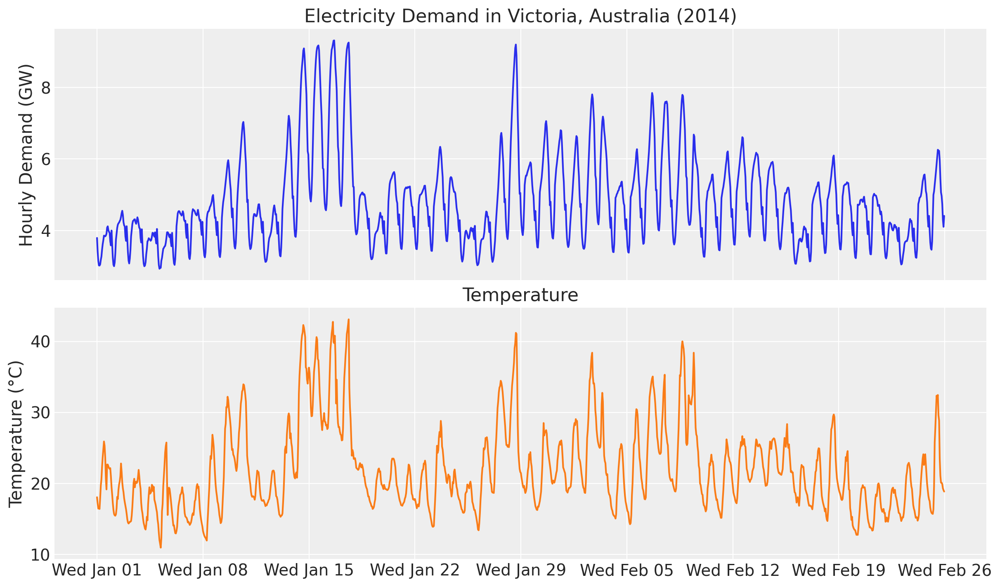</p>
</figure>


We clearly see an overall positive correlation between temperature and electricity demand. This can be particularly seen when we plot both demand and temperature in the same (twin) axis.


``` python
fig, ax = plt.subplots()
ax_twinx = ax.twinx()
ax.plot(demand_dates, demand_values, c="C0", label="Demand")
ax.set(
    title="Electricity Demand in Victoria, Australia (2014)",
    ylabel="Hourly Demand (GW)",
)
ax_twinx.plot(demand_dates, temperature_values, c="C1", label="Temperature")
ax_twinx.set(ylabel="Temperature (°C)")
ax.xaxis.set_major_locator(demand_loc)
ax.xaxis.set_major_formatter(demand_fmt)
ax_twinx.grid(None)
ax.legend(loc="upper left")
ax_twinx.legend(loc="upper right")
corr = np.corrcoef(temperature_values, demand_values)[0, 1]
fig.suptitle(
    f"Correlation between Temperature and Demand {corr:.3f}",
    fontsize=18,
    fontweight="bold",
);
```


<figure class="figure">
<p>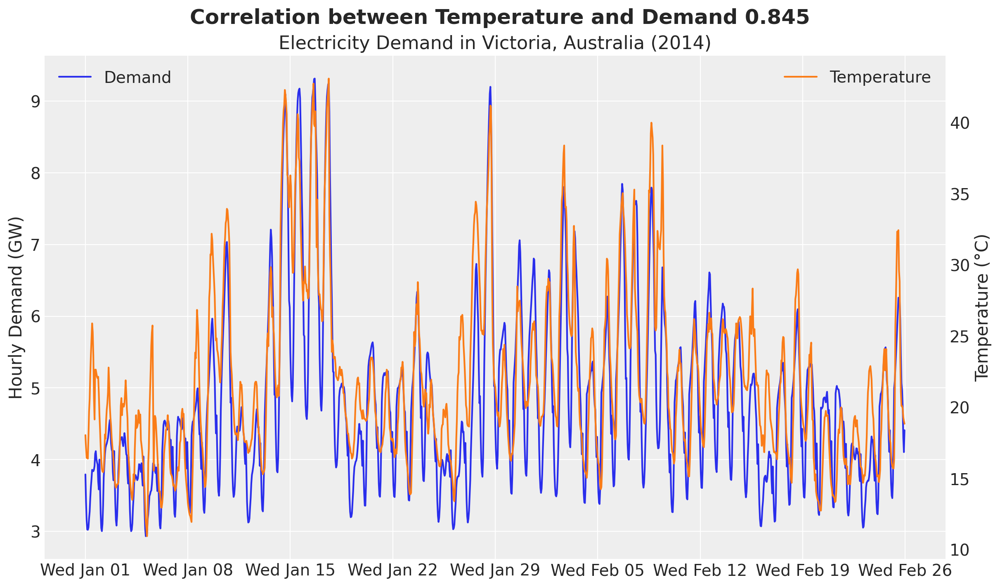</p>
</figure>


Besides forecasting, we would also like to understand the relationship between temperature and electricity demand. A good first starting point is to generate a scatter plot of temperature and demand.


``` python
fig, ax = plt.subplots()
ax.scatter(temperature_values, demand_values)
ax.set(title="Demand vs Temperature", xlabel="Temperature (°C)", ylabel="Demand (GW)");
```


<figure class="figure">
<p>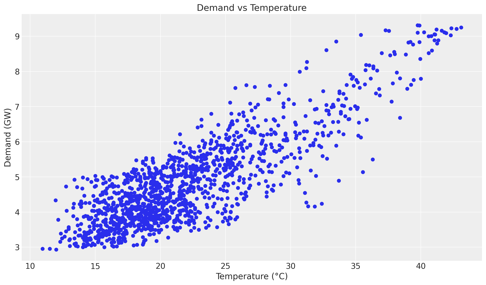</p>
</figure>


Even though we see a positive relationship between temperature and demand, the relationship is not linear. We can see this by plotting the ratio of demand to temperature.


``` python
fig, ax = plt.subplots()
ax.scatter(temperature_values, demand_values / temperature_values, c=demand_values, cmap="viridis")
cbar = fig.colorbar(ax.collections[0], ax=ax)
cbar.set_label("Demand (GW)")
ax.set(
    title="Demand / Temperature vs Temperature",
    xlabel="Temperature (°C)",
    ylabel="Demand / Temperature",
);
```


<figure class="figure">
<p>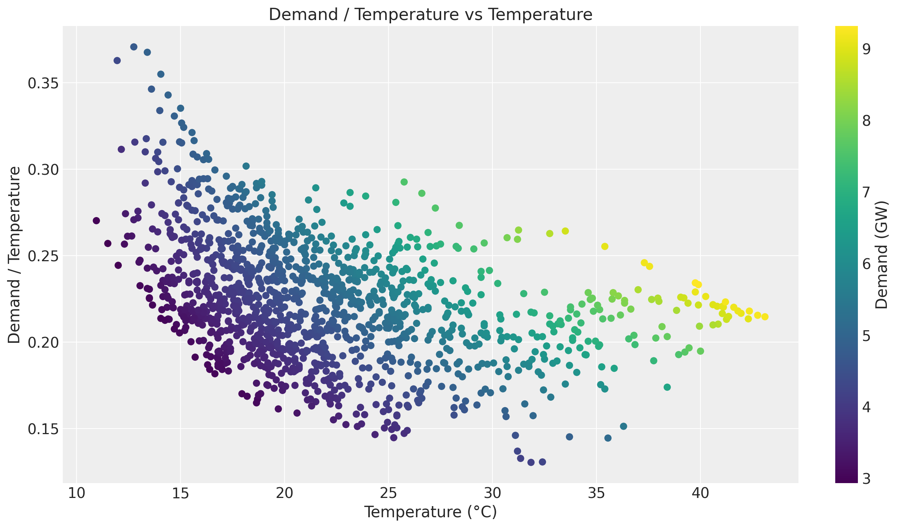</p>
</figure>


Of course there are strong seasonal effects hidden in these plots. Therefore we want to use a model that can capture the temperature effect while controlling for other factors.


# Training and test data

We split the data as in the original example, holding out the last two weeks. In addition, we build the exogenous inputs the model needs and pack them into a single `covariates` array with time at axis `-2`: the temperature and a `day_of_week` index. The forecast horizon is inferred later from `covariates` being longer than the training data. We also keep the training and test temperatures as arrays, because the HSGP setup below is computed from the training temperatures.


``` python
num_forecast_steps = 24 * 7 * 2  # two weeks
t_train = duration - num_forecast_steps

data_train = demand[:t_train]  # (1008, 1)
data_test = demand[t_train:]  # (336, 1)

dates_train = demand_dates[:t_train]
dates_test = demand_dates[t_train:]

day_of_week = np.array([d.weekday() for d in demand_dates.astype("datetime64[D]").astype(object)])

# (1344, 2): temperature, day of week
covariates = jnp.stack([temperature, jnp.asarray(day_of_week, dtype=jnp.float32)], axis=-1)
covariates_train = covariates[:t_train]  # (1008, 2)
temperature_train = np.asarray(temperature[:t_train])  # (1008,)
temperature_test = np.asarray(temperature[t_train:])  # (336,)
```


We can now visualize the training and test split of the demand and of the temperature. The panel titles give the spread of each window.


``` python
demand_std_train = np.std(np.asarray(data_train))
demand_std_test = np.std(np.asarray(data_test))

fig, ax = plt.subplots(nrows=2, ncols=1, sharex=True, sharey=False, layout="constrained")
ax[0].plot(dates_train, np.asarray(data_train[:, 0]), label="Training Data")
ax[0].plot(dates_test, np.asarray(data_test[:, 0]), label="Test Data")
ax[0].set(
    title=(
        f"Demand (standard deviation: train {demand_std_train:.2f} GW, "
        f"test {demand_std_test:.2f} GW)"
    ),
    ylabel="Demand (GW)",
)
ax[1].plot(dates_train, temperature_train, label="Training Data")
ax[1].plot(dates_test, temperature_test, label="Test Data")
ax[1].set(
    title=(
        f"Temperature (range: train [{temperature_train.min():.2f}, "
        f"{temperature_train.max():.2f}] °C, test [{temperature_test.min():.2f}, "
        f"{temperature_test.max():.2f}] °C)"
    ),
    ylabel="Temperature (°C)",
)

for panel in ax:
    panel.axvline(x=dates_train[-1], color="black", linestyle="--", label="Training-Test Split")

ax[1].xaxis.set_major_locator(demand_loc)
ax[1].xaxis.set_major_formatter(demand_fmt)
fig.legend(*ax[0].get_legend_handles_labels(), loc="outside lower center", ncols=3)
fig.suptitle("Training and Test Split", fontsize=18, fontweight="bold");
```


<figure class="figure">
<p>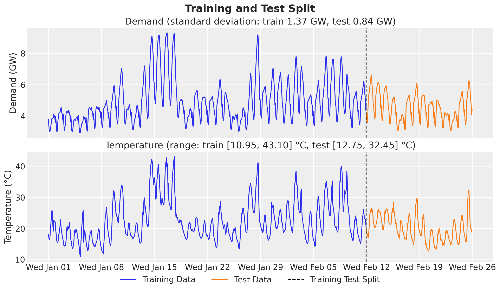</p>
</figure>


The test window is milder and calmer than the training window. Its temperature stays in \[12.75, 32.45\] °C, while the training weeks reach 43.10 °C, with the heat waves of mid January and early February. The demand standard deviation is 0.84 GW on the test window against 1.37 GW on the training window, and the test window has none of the demand peaks of mid January. Keep this in mind when we compare train and test scores below.


# Model specification

Here is the modeling strategy, re-expressed as a plain NumPyro model function built with the `numpyro_forecast` [predict](../../reference/models.predict.md#numpyro_forecast.models.predict) building block:

- A linear-in-features model predicts demand from temperature and two seasonal effects, hour of day and day of week, both modeled with Zero-Sum Normal distributions.
- A Matérn 5/2 kernel models the temperature effect on demand through the Hilbert Space Gaussian Process (HSGP) approximation from NumPyro (see [here](https://num.pyro.ai/en/stable/contrib.html#hilbert-space-gaussian-processes-approximation)).
- The noise scale varies with the temperature.
- A Student-t distribution models the residual error.

The model function `(covariates, data=None)` opens with `Horizon.from_data(covariates, data)`, which derives the training window and the forecast horizon from the two shapes, reads its exogenous inputs from `covariates`, and calls [predict](../../reference/models.predict.md#numpyro_forecast.models.predict) exactly once with a zero-centered noise distribution and the deterministic mean. Because there is no random-walk latent here, the model is purely covariate-driven and [predict](../../reference/models.predict.md#numpyro_forecast.models.predict) handles both the in-sample fit (the `obs` site) and the forecast suffix (`obs_future` and the [forecast](../../reference/predictive.forecast.md#numpyro_forecast.predictive.forecast) deterministic), including the per-timestep noise scale. Over the forecast horizon the model reads the temperature from `covariates`, as it reads the calendar. The calendar is known in advance, but the temperature is not, so the temperature path we pass decides what the forecast knows about the weather. We come back to this in the forecast evaluation.

The GP input is the temperature minus `TEMP_CENTER`, the midpoint of the training temperature range. NumPyro's `ell` argument (the constant `ELL`) is the half-width L of the box \[-L, L\] that must contain the GP input; it is not a factor of the data range, as `c` is in PyMC. We set L to twice the training half-range S, so the centered training temperatures fill the middle half of the box. For a Matérn 5/2 kernel, Riutort-Mayol et al. (2023) give the box factor c = L / S and the number of basis functions M that keep the approximation accurate at a length scale \ell:

 c \ge \max\left(1.2,\\ 4.1\\\frac{\ell}{S}\right), \qquad M \ge 2.65\\\frac{c\\S}{\ell}. 

The *Accuracy of the HSGP approximation* section applies this rule to the length scale the fit selects. `TEMP_CENTER` and `ELL` are module constants computed from the training temperatures, and the number of basis functions `M` is a module constant too. A center computed inside the model from `covariates` would be a statistic of the training window during the fit and of the full horizon during the forecast, so the basis functions would change between the two. The linear term `beta_temperature * temperature` and the noise scale use the raw temperature.


## GP prior parameters

One key component of specifying Gaussian processes is to set the length scale and amplitude parameters. We use an optimization strategy (`preliz`) to set these parameters by assuming they both come from an Inverse-Gamma distribution while specifying the support.

We pass `mass=0.94` explicitly, so each prior puts 94\\ of its probability between the bounds (the same probability as the 94\\ HDI bands of the plots later in this notebook). The default `mass` is the preliz setting `rcParams["stats.ci_prob"]`, which changed between preliz releases, so without it the priors would depend on the installed version.


``` python
# For the amplitude, we set the values inspired on the range of the demand / temperature
# ratio above.
amplitude_params, ax = pz.maxent(pz.InverseGamma(), lower=0.1, upper=0.5, mass=0.94)
```


<figure class="figure">
<p>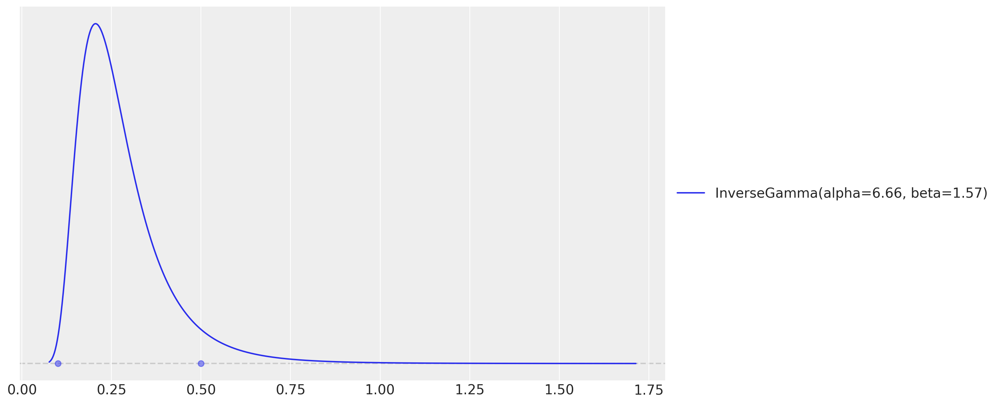</p>
</figure>


``` python
# As we want to use the GP to model the temperature effect, we need to set the length
# scale parameter. We expect these effects to be seen at the order of units or tens of
# units, so we expect the length scale to be between 3 and 10.
LENGTH_SCALE_LOWER = 3.0
LENGTH_SCALE_UPPER = 10.0
length_scale_params, ax = pz.maxent(
    pz.InverseGamma(), lower=LENGTH_SCALE_LOWER, upper=LENGTH_SCALE_UPPER, mass=0.94
)
```


<figure class="figure">
<p>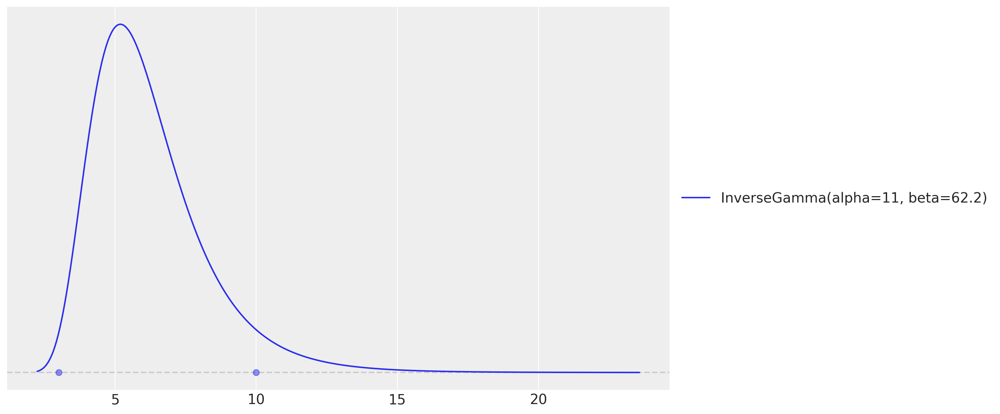</p>
</figure>


These two `maxent` calls return the fitted Inverse-Gamma distributions. The model below builds its amplitude and length-scale priors from their `alpha` and `beta` parameters, so the priors in the model are the priors in the plots above (the hour-of-day effect is tiled over the horizon with the package helper [periodic_repeat](../../reference/features.periodic_repeat.md#numpyro_forecast.features.periodic_repeat)).


``` python
# HSGP input: the temperature centered on the training midrange. NumPyro's ``ell`` is the
# half-width L of the box [-L, L] that must contain the centered input, not a factor of the
# data range; we take twice the training half-range. Both constants come from the training
# temperatures, never from ``covariates`` inside the model (it sees other covariates at
# forecast time).
TEMP_CENTER = float(temperature_train.min() + temperature_train.max()) / 2
TEMP_HALF_RANGE = float(temperature_train.max() - temperature_train.min()) / 2
ELL = 2.0 * TEMP_HALF_RANGE  # HSGP box half-width L
M = 25  # number of HSGP basis functions
# GP priors from the maxent fits above (preliz alpha, beta are NumPyro concentration, rate).
AMPLITUDE_PRIOR = dist.InverseGamma(
    concentration=amplitude_params.alpha, rate=amplitude_params.beta
)
LENGTH_SCALE_PRIOR = dist.InverseGamma(
    concentration=length_scale_params.alpha, rate=length_scale_params.beta
)


def electricity_model(
    covariates: Array, data: Array | None = None, *, ell: float = ELL, m: int = M
) -> None:
    """HSGP temperature effect plus hour/day seasonality with a Student-t likelihood.

    ``ell`` and ``m`` set the HSGP box half-width and the number of basis functions.
    """
    h = Horizon.from_data(covariates, data)
    duration = covariates.shape[-2]
    temperature = covariates[..., 0]
    day_of_week = covariates[..., 1].astype("int32")

    # Intercept.
    intercept = numpyro.sample("intercept", dist.Normal(loc=0.0, scale=2.0))

    # GP parameters (amplitude and length-scale priors are the preliz maxent fits).
    alpha = numpyro.sample("alpha", AMPLITUDE_PRIOR)
    length_scale = numpyro.sample("length_scale", LENGTH_SCALE_PRIOR)
    scale_factor = numpyro.sample("scale", dist.HalfNormal(scale=0.5))
    # Degrees of freedom for the Student-t likelihood.
    nu = numpyro.sample("nu", dist.Gamma(concentration=8.0, rate=3.0))

    # Non-linear temperature effect as a Matérn 5/2 HSGP of the centered temperature.
    # ``hsgp_matern`` is annotated for float hyperparameters, so we cast the sampled scalars.
    beta_temperature = hsgp_matern(
        x=temperature - TEMP_CENTER,
        nu=5 / 2,
        alpha=cast("float", alpha),
        length=cast("float", length_scale),
        ell=ell,
        m=m,
    )
    numpyro.deterministic("beta_temperature", beta_temperature)

    # Hour-of-day effect, tiled over the horizon with periodic_repeat.
    scale_hour_of_day = numpyro.sample("scale_hour_of_day", dist.HalfNormal(scale=0.5))
    hour_of_day_effect = numpyro.sample(
        "hour_of_day_effect",
        dist.ZeroSumNormal(scale=scale_hour_of_day, event_shape=(24,)),
    )
    hour_of_day_effect = periodic_repeat(hour_of_day_effect, duration, axis=-1)

    # Day-of-week effect, indexed by the calendar covariate.
    scale_day_of_week = numpyro.sample("scale_day_of_week", dist.HalfNormal(scale=0.5))
    day_of_week_effect = numpyro.sample(
        "day_of_week_effect",
        dist.ZeroSumNormal(scale=scale_day_of_week, event_shape=(7,)),
    )

    # Expected demand and a temperature-dependent Student-t noise scale.
    mu = (
        beta_temperature * temperature
        + intercept
        + hour_of_day_effect
        + jnp.take(day_of_week_effect, day_of_week)
    )
    scale = scale_factor * jnp.sqrt(temperature)

    predict(h, dist.StudentT(df=nu, loc=0.0, scale=scale[..., None]), mu[..., None])
```


The model function is a plain NumPyro model callable `(covariates, data=None)`, so we can render its structure directly.


``` python
numpyro.render_model(
    electricity_model,
    model_args=(covariates_train, data_train),
    render_distributions=True,
    render_params=True,
)
```


<figure class="figure">
<p>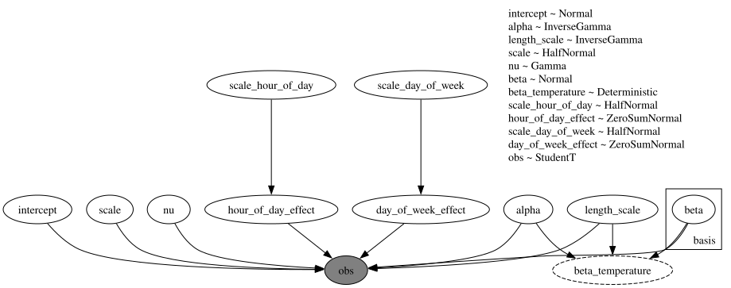</p>
</figure>


# Prior predictive checks

Before we fit the model, let's visualize the prior predictive distribution. The model function is a plain NumPyro model, so we hand it to `Predictive` directly. We draw the bands with ArviZ's `plot_lm`, which computes the 50\\ and 94\\ HDI internally; since the time axis is a `datetime64` array we pass it as matplotlib date numbers (`mdates.date2num`) and restore the date formatter on the returned axis.


``` python
prior_predictive = Predictive(electricity_model, num_samples=2_000, return_sites=["obs"])
rng_key, rng_subkey = random.split(rng_key)
prior_obs = prior_predictive(rng_subkey, covariates_train)["obs"][..., 0]

xnum_train = mdates.date2num(dates_train)

idata_prior = az.from_dict(
    {
        "prior_predictive": {"obs": np.asarray(prior_obs)[None]},
        "observed_data": {"obs": np.asarray(data_train[:, 0])},
        "constant_data": {"date": xnum_train},
    },
    coords={"time": xnum_train},
    dims={"obs": ["time"], "date": ["time"]},
)
pc = az.plot_lm(
    idata_prior,
    y="obs",
    x="date",
    group="prior_predictive",
    ci_kind="hdi",
    ci_prob=(0.5, 0.94),
    smooth=False,
    visuals={"ci_band": {"color": "C0"}, "observed_scatter": False, "pe_line": False},
    figure_kwargs={"figsize": (12, 7)},
)
ax = pc.viz["figure"].item().axes[0]
bands = pc.viz["ci_band"]["date"]
band_94, band_50 = bands.sel(prob=0.94).item(), bands.sel(prob=0.5).item()
band_94.set_label(r"$94\%$ HDI")
band_50.set_label(r"$50\%$ HDI")
(train_line,) = ax.plot(
    xnum_train, np.asarray(data_train[:, 0]), c="black", lw=1, label="Training Data"
)
ax.xaxis.set_major_locator(demand_loc)
ax.xaxis.set_major_formatter(demand_fmt)
ax.legend(handles=[band_94, band_50, train_line])
ax.set(title="Prior Predictive Checks", ylabel="Demand (GW)", xlabel="Time");
```


<figure class="figure">
<p>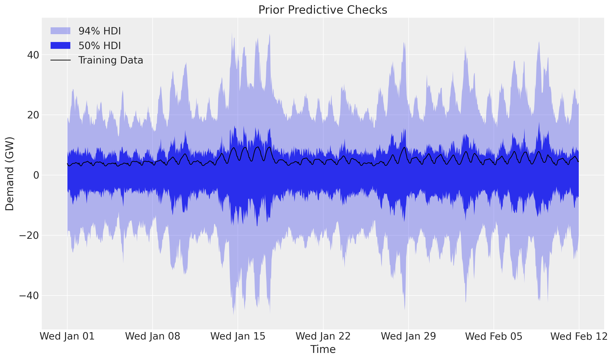</p>
</figure>


The prior predictive 94\\ band is several times wider than the range of the training demand and includes negative demand. The prior is weak, so the demand data do most of the work.


# Inference with SVI

We fit the model with plain NumPyro stochastic variational inference: an `AutoNormal` guide, `Adam`, and `SVI.run`, which returns the fitted `params` and the ELBO `losses`. The posterior is multimodal: the multiplicative `beta_temperature * temperature` term trades off against the overall level, so the starting point of the guide decides which mode SVI reaches. We initialize the guide at a feasible point (`init_to_feasible`). Two sections below check how accurate the HSGP approximation is at the fitted length scale and which parts of the fitted coefficient depend on the HSGP box.


``` python
rng_key, rng_subkey = random.split(rng_key)
guide = AutoNormal(electricity_model, init_loc_fn=init_to_feasible)
svi = SVI(electricity_model, guide, Adam(step_size=0.005), Trace_ELBO())
svi_result = svi.run(rng_subkey, 50_000, covariates_train, data_train, progress_bar=False)

fig, ax = plt.subplots(figsize=(9, 6))
ax.plot(svi_result.losses)
ax.set_yscale("log")
ax.set_title("ELBO loss", fontsize=18, fontweight="bold");
```


<figure class="figure">
<p>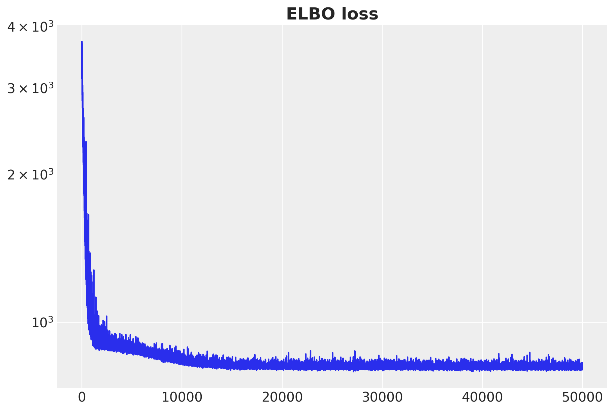</p>
</figure>


The ELBO loss is decreasing as expected.


# Posterior predictive checks

We now draw posterior latents from the fitted guide with [draw_posterior](../../reference/predictive.draw_posterior.md#numpyro_forecast.predictive.draw_posterior), push them through the model over the training window with [predict_in_sample](../../reference/predictive.predict_in_sample.md#numpyro_forecast.predictive.predict_in_sample), and forecast the held-out two weeks with [forecast](../../reference/predictive.forecast.md#numpyro_forecast.predictive.forecast) and the full-horizon covariates. Their temperature column holds the realized temperatures of the test window, so this forecast assumes a perfect weather forecast. To see what that knowledge is worth, we also forecast with a **climatology** temperature path: the hour-of-day mean of the training temperatures, repeated over the two test weeks. It uses only training data, so it is available at forecast time, and it needs no refit, only a second [forecast](../../reference/predictive.forecast.md#numpyro_forecast.predictive.forecast) call on the same posterior. [draw_posterior](../../reference/predictive.draw_posterior.md#numpyro_forecast.predictive.draw_posterior) returns the deterministic sites along with the latents, so the posterior dictionary already carries `beta_temperature` for the temperature-effect plot later.


``` python
num_posterior_samples = 5_000

rng_key, key_post, key_pp, key_fc = random.split(rng_key, 4)
posterior = draw_posterior(key_post, guide, svi_result.params, num_posterior_samples)
train_pp = predict_in_sample(key_pp, electricity_model, posterior, covariates_train)
forecast_draws = forecast(key_fc, electricity_model, posterior, data_train, covariates)

# Climatology: the hour-of-day mean of the training temperatures. The training window holds
# whole days that start at midnight, so each row of the reshape is one day.
temperature_climatology = temperature_train.reshape(-1, 24).mean(axis=0)
# (1344, 2): temperature (realized in training, climatology over the test window), day of week
covariates_climatology = covariates.at[t_train:, 0].set(
    jnp.tile(temperature_climatology, num_forecast_steps // 24)
)
# Same key as above: both forecasts use the same draws and differ only in the temperature.
forecast_climatology = forecast(
    key_fc, electricity_model, posterior, data_train, covariates_climatology
)
```


## Forecast evaluation

We score the train and test forecasts with [evaluate_forecast](../../reference/evaluate.evaluate_forecast.md#numpyro_forecast.evaluate.evaluate_forecast), which reports several metrics at once: CRPS (the [Continuous Ranked Probability Score](https://en.wikipedia.org/wiki/Scoring_rule#Continuous_ranked_probability_score)), mean absolute error, root mean squared error, and the empirical coverage of the central 90\\ prediction interval. Both test forecasts are scored against the same held-out demand, and the point chart below shows the CRPS and the coverage of each forecast.


``` python
train_metrics = evaluate_forecast(train_pp, data_train)
test_metrics = evaluate_forecast(forecast_draws, data_test)
climatology_metrics = evaluate_forecast(forecast_climatology, data_test)

# Point chart of CRPS and coverage, one point per forecast, with the values annotated.
score_labels = ["train", "test", "test (climatology)"]
scores = [train_metrics, test_metrics, climatology_metrics]
fig, ax = plt.subplots(nrows=1, ncols=2, figsize=(12, 6), layout="constrained")
score_panels = [
    (ax[0], "crps", "CRPS (lower is better)"),
    (ax[1], "coverage", r"Coverage of the central $90\%$ interval"),
]

for panel, metric, title in score_panels:
    values = [float(score[metric]) for score in scores]
    panel.plot(range(len(values)), values, "o", color="C0", markersize=10)

    for position, value in enumerate(values):
        panel.annotate(
            f"{value:.3f}",
            xy=(position, value),
            xytext=(12, 0),
            textcoords="offset points",
            va="center",
        )

    panel.set(title=title, xticks=range(len(values)), xticklabels=score_labels)
    panel.set_xlim(-0.5, len(values) - 0.3)

nominal_line = ax[1].axhline(0.9, color="black", linestyle="--", label=r"nominal $90\%$")
fig.legend(handles=[nominal_line], loc="outside lower center")
fig.suptitle("Forecast Scores", fontsize=18, fontweight="bold");
```


<figure class="figure">
<p>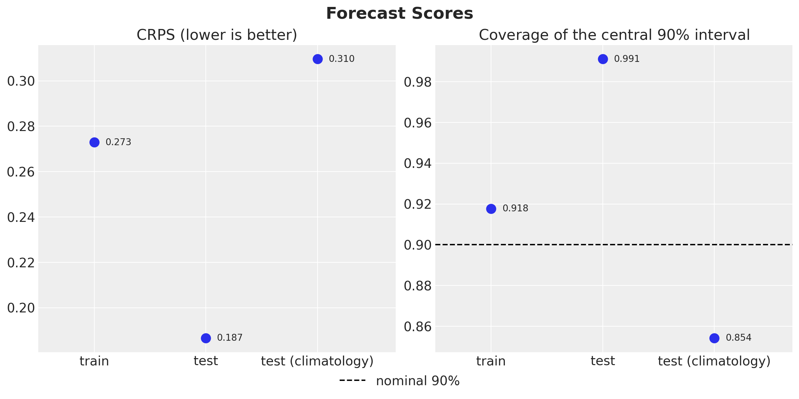</p>
</figure>


The `test` score is conditional on the realized temperatures of the test window: it scores the model with a perfect weather forecast, so it is an optimistic reading of the forecast accuracy. Its CRPS (0.187) is lower than the train CRPS (0.273), but the two do not test generalization. The train score is computed on the data the model was fitted to, and the test window is calmer and milder (see the split plot above). The central 90\\ interval covers 0.918 of the training hours and 0.991 of the test hours, so it is too wide on the test window. The `test (climatology)` forecast uses only what is known at forecast time, and its CRPS is 0.310. Its coverage drops to 0.854, but that forecast treats one temperature path as known, so its bands leave out the uncertainty of the weather and its coverage is conditional on that path. We can now compare the posterior predictive distribution with the training and test data.


``` python
train_obs = train_pp[..., 0]
forecast_obs = forecast_draws[..., 0]

xnum_test = mdates.date2num(dates_test)

idata_train = az.from_dict(
    {
        "posterior_predictive": {"obs": np.asarray(train_obs)[None]},
        "observed_data": {"obs": np.asarray(data_train[:, 0])},
        "constant_data": {"date": xnum_train},
    },
    coords={"time": xnum_train},
    dims={"obs": ["time"], "date": ["time"]},
)
idata_test = az.from_dict(
    {
        "posterior_predictive": {"obs": np.asarray(forecast_obs)[None]},
        "observed_data": {"obs": np.asarray(data_test[:, 0])},
        "constant_data": {"date": xnum_test},
    },
    coords={"time": xnum_test},
    dims={"obs": ["time"], "date": ["time"]},
)

pc = az.plot_lm(
    idata_train,
    y="obs",
    x="date",
    ci_kind="hdi",
    ci_prob=(0.5, 0.94),
    smooth=False,
    visuals={"ci_band": {"color": "C0"}, "observed_scatter": False, "pe_line": False},
    figure_kwargs={"figsize": (12, 7)},
)
train_bands = pc.viz["ci_band"]["date"]
band_train_94 = train_bands.sel(prob=0.94).item()
band_train_50 = train_bands.sel(prob=0.5).item()
az.plot_lm(
    idata_test,
    y="obs",
    x="date",
    plot_collection=pc,
    ci_kind="hdi",
    ci_prob=(0.5, 0.94),
    smooth=False,
    visuals={"ci_band": {"color": "C1"}, "observed_scatter": False, "pe_line": False},
)
test_bands = pc.viz["ci_band"]["date"]
band_test_94 = test_bands.sel(prob=0.94).item()
band_test_50 = test_bands.sel(prob=0.5).item()
ax = pc.viz["figure"].item().axes[0]
band_train_94.set_label(r"in-sample $94\%$ HDI")
band_train_50.set_label(r"in-sample $50\%$ HDI")
band_test_94.set_label(r"forecast $94\%$ HDI")
band_test_50.set_label(r"forecast $50\%$ HDI")
obs_dates = mdates.date2num(np.concatenate([dates_train, dates_test]))
obs_values = np.concatenate([np.asarray(data_train[:, 0]), np.asarray(data_test[:, 0])])
(obs_line,) = ax.plot(obs_dates, obs_values, c="black", lw=1, label="Observed Data")
split_line = ax.axvline(x=xnum_train[-1], color="gray", linestyle="--", label="Train/Test Split")
ax.xaxis.set_major_locator(demand_loc)
ax.xaxis.set_major_formatter(demand_fmt)
ax.legend(
    handles=[band_train_94, band_train_50, band_test_94, band_test_50, obs_line, split_line],
    loc="upper center",
    bbox_to_anchor=(0.5, -0.1),
    ncol=3,
)
ax.set(
    title=(
        f"Train CRPS: {train_metrics['crps']:.3f}, "
        f"Test CRPS (realized temperatures): {test_metrics['crps']:.3f}"
    ),
    ylabel="Demand (GW)",
    xlabel="Time",
)
fig = pc.viz["figure"].item()
fig.suptitle("Posterior Predictive Checks", fontsize=18, fontweight="bold");
```


<figure class="figure">
<p>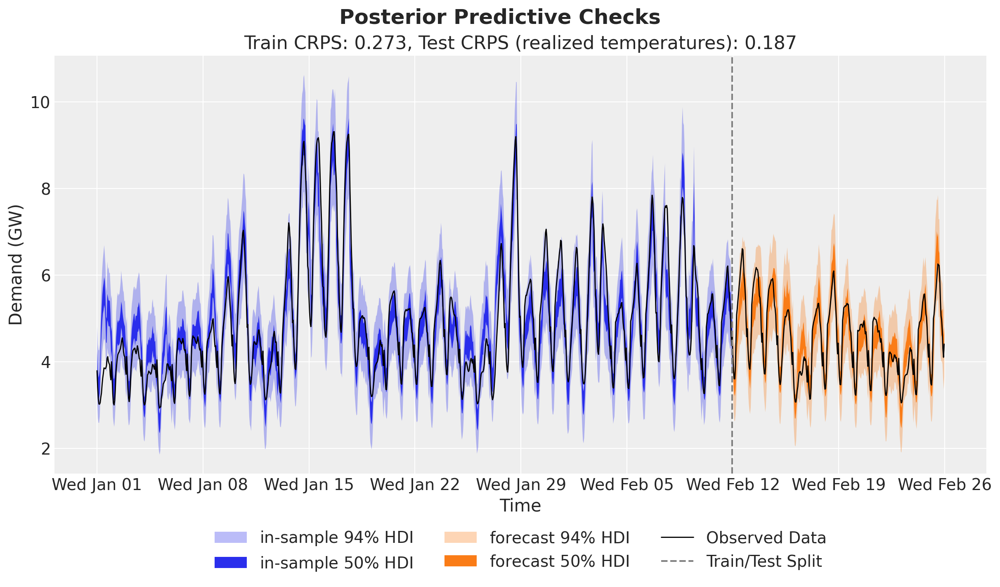</p>
</figure>


The in-sample bands follow the daily cycle and the heat-wave peaks of mid January. The forecast bands follow the test demand closely, because the forecast reads the realized test temperatures. The forecast bands are wide on the test window, most of all on the warmest test day at its end, which matches the test coverage of 0.991 in the score chart.


## Accuracy of the HSGP approximation

Before we read the fitted temperature coefficient, we check how well the HSGP approximation matches the Matérn 5/2 kernel at the length scale the fit selects. `matern52_correlation` computes the exact Matérn 5/2 correlation between pairs of temperatures, and `hsgp_correlation` computes its HSGP approximation, by default with the model's `TEMP_CENTER`, `ELL` and `M`. The **kernel error** is the largest absolute gap between the two over an evenly spaced grid on the training temperature range. The left panel compares the posterior length scale with its prior. The right panel shows the prior variance of the approximate GP along the training temperature range (the exact kernel with amplitude 1 has variance 1 everywhere) at the two prior bounds and at the posterior mean, with the kernel error of each in the legend; its title applies the box rule of Riutort-Mayol et al. (2023) from *Model specification*. The check needs no refit.


``` python
def matern52_correlation(x: Array, length_scale: float) -> Array:
    """Exact Matérn 5/2 correlation between every pair of inputs."""
    s = jnp.sqrt(5.0) * jnp.abs(x[:, None] - x[None, :]) / length_scale
    return (1 + s + s**2 / 3) * jnp.exp(-s)


def hsgp_correlation(x: Array, length_scale: float, ell: float = ELL, m: int = M) -> Array:
    """HSGP approximation of the same correlation, by default with the model's box and basis."""
    phi = eigenfunctions(x=x - TEMP_CENTER, ell=ell, m=m)
    spd = diag_spectral_density_matern(
        nu=5 / 2, alpha=1.0, length=length_scale, ell=ell, m=m, dim=1
    )
    return (phi * spd) @ phi.T


# Posterior length scale against the prior.
length_scale_draws = np.asarray(posterior["length_scale"])
posterior_length_scale = float(length_scale_draws.mean())
length_scale_hdi = az.hdi(length_scale_draws, prob=0.94)
prior_tail = float(1 - length_scale_params.cdf(posterior_length_scale))  # float64
mantissa, exponent = f"{prior_tail:.1e}".split("e")

# Largest kernel error on an evenly spaced grid over the training temperature range.
box_factor = ELL / TEMP_HALF_RANGE
accurate_up_to = box_factor * TEMP_HALF_RANGE / 4.1  # rule: c >= 4.1 * length_scale / S
needed_box_factor = 4.1 * posterior_length_scale / TEMP_HALF_RANGE
temperature_grid = jnp.linspace(temperature_train.min(), temperature_train.max(), 200)
checked_length_scales = (LENGTH_SCALE_LOWER, LENGTH_SCALE_UPPER, posterior_length_scale)
max_errors = [
    float(
        jnp.max(
            jnp.abs(
                hsgp_correlation(temperature_grid, length_scale)
                - matern52_correlation(temperature_grid, length_scale)
            )
        )
    )
    for length_scale in checked_length_scales
]

fig, ax = plt.subplots(
    nrows=1, ncols=2, figsize=(12, 8), width_ratios=[1, 1.2], layout="constrained"
)
length_scale_grid = np.linspace(0.5, 1.2 * length_scale_draws.max(), 1_000)
ax[0].plot(
    length_scale_grid,
    np.exp(np.asarray(LENGTH_SCALE_PRIOR.log_prob(jnp.asarray(length_scale_grid)))),
    c="C0",
    label="prior density",
)
ax[0].axvspan(
    LENGTH_SCALE_LOWER,
    LENGTH_SCALE_UPPER,
    color="C0",
    alpha=0.2,
    label=rf"prior $94\%$ mass: [{LENGTH_SCALE_LOWER:.0f}, {LENGTH_SCALE_UPPER:.0f}] °C",
)
ax[0].axvspan(
    *length_scale_hdi,
    color="C1",
    alpha=0.4,
    label=rf"posterior $94\%$ HDI: [{length_scale_hdi[0]:.2f}, {length_scale_hdi[1]:.2f}] °C",
)
ax[0].axvline(
    posterior_length_scale,
    color="C1",
    linestyle="--",
    label=f"posterior mean: {posterior_length_scale:.2f} °C",
)
ax[0].set(
    title=(
        "Length scale\nprior probability above\n"
        rf"the posterior mean: ${mantissa} \times 10^{{{int(exponent)}}}$"
    ),
    xlabel="Length scale (°C)",
    ylabel="Prior density",
)

for color, length_scale, max_error in zip(
    ["C0", "C2", "C1"], checked_length_scales, max_errors, strict=True
):
    ax[1].plot(
        temperature_grid,
        jnp.diag(hsgp_correlation(temperature_grid, length_scale)),
        c=color,
        label=f"HSGP, length scale {length_scale:.2f} °C: max kernel error {max_error:.3f}",
    )

ax[1].axhline(1.0, color="black", linestyle="--", label="exact Matérn 5/2")
ax[1].set(
    title=(
        "Prior variance of the HSGP (amplitude 1)\n"
        f"c = {box_factor:.0f} is accurate up to {accurate_up_to:.1f} °C\n"
        f"the posterior mean needs c ≥ {needed_box_factor:.1f}"
    ),
    xlabel="Temperature (°C)",
    ylabel="Variance",
)
handles_0, labels_0 = ax[0].get_legend_handles_labels()
handles_1, labels_1 = ax[1].get_legend_handles_labels()
fig.legend(handles_0 + handles_1, labels_0 + labels_1, loc="outside lower center", ncols=2)
fig.suptitle("HSGP Approximation at the Posterior Length Scale", fontsize=18, fontweight="bold");
```


<figure class="figure">
<p>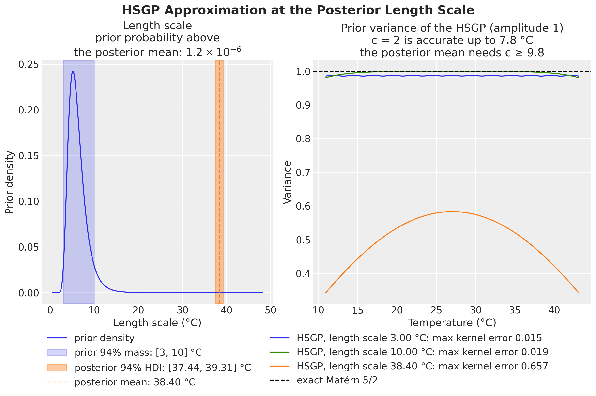</p>
</figure>


At both bounds of the prior range the approximation is accurate: the kernel error is 0.015 at a length scale of 3 °C and 0.019 at a length scale of 10 °C. The posterior length scale is 38.40 °C (94\\ HDI \[37.44, 39.31\] °C), far outside that range: the prior gives a probability of 1.2 \times 10^{-6} to a length scale above it, so the data and the prior disagree. By the rule of Riutort-Mayol et al., c = 2 is accurate only up to a length scale of 7.8 °C, and the posterior mean would need c \ge 9.8. At the posterior length scale the kernel error is 0.657, and the prior variance of the approximation is well below 1 over the whole range. So the fitted coefficient is not the posterior of a Matérn 5/2 GP. The next section reads the coefficient, and the section after it checks which of its features depend on the box.


## Temperature effect on demand

Next we look at the temperature effect. First we simply plot the predictions and the raw values against temperature, sorting by temperature so the HDI band reads cleanly.


``` python
order = np.argsort(temperature_train)

idata_demand = az.from_dict(
    {
        "posterior_predictive": {"obs": np.asarray(train_obs[:, order])[None]},
        "observed_data": {"obs": np.asarray(data_train[order, 0])},
        "constant_data": {"temperature": temperature_train[order]},
    },
    dims={"obs": ["obs_dim"], "temperature": ["obs_dim"]},
)
pc = az.plot_lm(
    idata_demand,
    y="obs",
    x="temperature",
    ci_kind="hdi",
    ci_prob=(0.5, 0.94),
    visuals={"ci_band": {"color": "C0"}, "observed_scatter": False, "pe_line": False},
    figure_kwargs={"figsize": (12, 7)},
)
ax = pc.viz["figure"].item().axes[0]
bands = pc.viz["ci_band"]["temperature"]
band_94, band_50 = bands.sel(prob=0.94).item(), bands.sel(prob=0.5).item()
band_94.set_label(r"$94\%$ HDI")
band_50.set_label(r"$50\%$ HDI")
ax.scatter(temperature_train, np.asarray(data_train[:, 0]), c="black", s=10)
ax.legend(handles=[band_94, band_50], loc="upper left", bbox_to_anchor=(1.01, 1.0))
ax.set(title="Demand vs Temperature", xlabel="Temperature (°C)", ylabel="Demand (GW)");
```


<figure class="figure">
<p>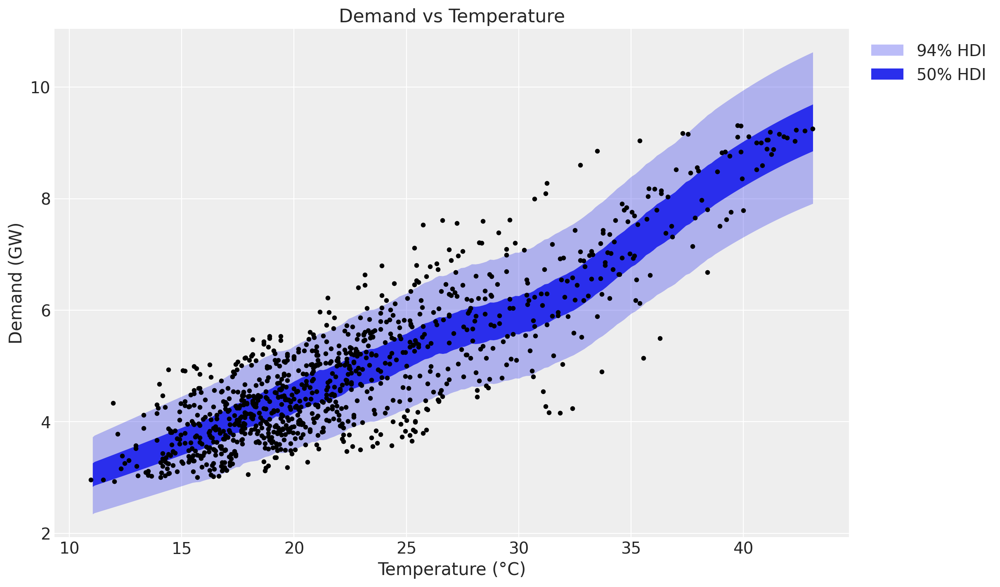</p>
</figure>


The posterior demand band bends upward above about 32 °C, where the scatter also gets steeper. Next we look at the latent relationship between temperature and demand: the posterior distribution of the Gaussian Process component `beta_temperature`, the per-degree coefficient that multiplies the temperature in the mean. The annotations give the posterior mean coefficient and the posterior mean contribution `beta_temperature * temperature` at the coldest training hour, at the lowest coefficient and at the hottest training hour.


``` python
beta_temperature = posterior["beta_temperature"]

idata_beta = az.from_dict(
    {
        "posterior_predictive": {"obs": np.asarray(beta_temperature[:, order])[None]},
        "observed_data": {"obs": np.zeros_like(temperature_train[order])},
        "constant_data": {"temperature": temperature_train[order]},
    },
    dims={"obs": ["obs_dim"], "temperature": ["obs_dim"]},
)
pc = az.plot_lm(
    idata_beta,
    y="obs",
    x="temperature",
    ci_kind="hdi",
    ci_prob=(0.5, 0.94),
    visuals={"ci_band": {"color": "C1"}, "observed_scatter": False, "pe_line": False},
    figure_kwargs={"figsize": (12, 7)},
)
ax = pc.viz["figure"].item().axes[0]
bands = pc.viz["ci_band"]["temperature"]
band_94, band_50 = bands.sel(prob=0.94).item(), bands.sel(prob=0.5).item()
band_94.set_label(r"$94\%$ HDI")
band_50.set_label(r"$50\%$ HDI")

# Annotate the posterior mean coefficient and contribution at three training hours.
beta_mean = np.asarray(beta_temperature.mean(axis=0))
contribution_mean = np.asarray((beta_temperature * temperature_train).mean(axis=0))
annotated_hours = [
    (order[0], (10, 45), "left"),
    (int(beta_mean.argmin()), (0, 55), "center"),
    (order[-1], (-10, -70), "right"),
]

for i, offset, ha in annotated_hours:
    ax.annotate(
        f"{temperature_train[i]:.2f} °C: coefficient {beta_mean[i]:.3f}\n"
        f"contribution {contribution_mean[i]:.2f} GW",
        xy=(temperature_train[i], beta_mean[i]),
        xytext=offset,
        textcoords="offset points",
        ha=ha,
        bbox={"boxstyle": "round", "fc": "white", "alpha": 0.8},
        arrowprops={"arrowstyle": "->"},
    )

ax.legend(handles=[band_94, band_50], loc="upper left", bbox_to_anchor=(1.01, 1.0))
ax.set(
    title="Temperature Coefficient",
    xlabel="Temperature (°C)",
    ylabel="Coefficient (GW per °C)",
);
```


<figure class="figure">
<p>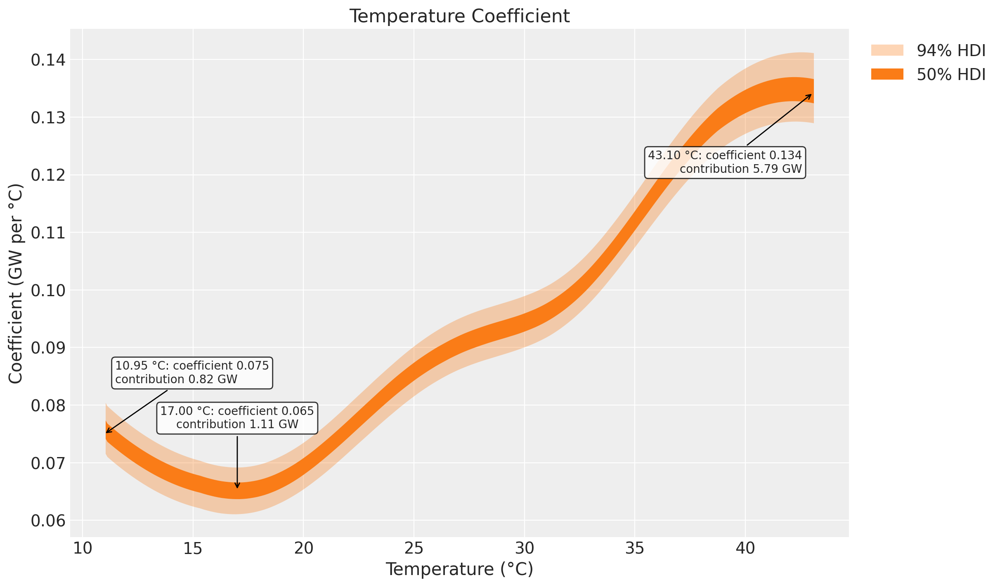</p>
</figure>


The coefficient rises from the mild temperatures to the hottest training hours, and its 94\\ band at the hot end separates from the rest of the curve. This matches the steeper demand above 32 °C in the previous plot and the air-conditioning part of the exploratory comment by Hyndman and Athanasopoulos at https://otexts.com/fpp2/scatterplots.html:

> *"It is clear that high demand occurs when temperatures are high due to the effect of air-conditioning. But there is also a heating effect, where demand increases for very low temperatures."*

The model does not show the heating part. The coefficient is higher at the coldest training hour (0.075 at 10.95 °C) than at its minimum (0.065 at 17.00 °C), but the contribution `beta_temperature * temperature` still grows with temperature there: 0.82 GW at 10.95 °C against 1.11 GW at 17.00 °C. The next section checks which of these features the data determine and which depend on the HSGP box.


## Which parts of the coefficient depend on the box

The data cannot pin down the whole coefficient curve. The temperature T enters the mean only through the product `beta_temperature * temperature`, and the mean also has an intercept. Adding k / T to the coefficient \beta(T) adds the same constant k to the mean at every hour,

 \left(\beta(T) + \frac{k}{T}\right) T + \text{intercept} = \beta(T)\\T + (\text{intercept} + k), 

so the likelihood of the demand cannot tell the two curves apart once the intercept absorbs k. The term k / T is about four times larger at the coldest training hour (10.95 °C) than at the hottest (43.10 °C), so this freedom moves the cold end of the coefficient most, and the GP prior, through the HSGP approximation, decides that part of the curve. A difference of contributions between two hours does not change with k. We use the **contribution gap**: the posterior mean of the contribution `beta_temperature * temperature` at the hottest training hour minus the one at the coldest training hour.

To see what depends on the box, we refit the same model with a box of five times the training half-range and the number of basis functions that the rule asks for at the lower prior bound of 3 °C. By the rule, this box is accurate for length scales from 3 °C up to about 19.6 °C. The model function takes `ell` and `m` as keyword arguments, so `functools.partial` gives the refit the `(covariates, data=None)` signature. The refit reuses the keys of the first fit.


``` python
# Box of five times the training half-range, with the number of basis functions that the rule
# m >= 2.65 * c * S / length_scale asks for at the lower prior bound.
WIDE_BOX_FACTOR = 5.0
WIDE_ELL = WIDE_BOX_FACTOR * TEMP_HALF_RANGE
WIDE_M = int(np.ceil(2.65 * WIDE_BOX_FACTOR * TEMP_HALF_RANGE / LENGTH_SCALE_LOWER))
wide_model = partial(electricity_model, ell=WIDE_ELL, m=WIDE_M)

# Same guide, optimizer, steps and keys as the first fit.
wide_guide = AutoNormal(wide_model, init_loc_fn=init_to_feasible)
wide_svi = SVI(wide_model, wide_guide, Adam(step_size=0.005), Trace_ELBO())
wide_result = wide_svi.run(rng_subkey, 50_000, covariates_train, data_train, progress_bar=False)
wide_posterior = draw_posterior(key_post, wide_guide, wide_result.params, num_posterior_samples)
```


The figure compares the posterior coefficient of the two fits. Each legend entry gives the box, the posterior length scale of the fit, the kernel error at that length scale, the posterior mean coefficient at the coldest and the hottest training hour, and the contribution gap.


``` python
# One entry per box: label, posterior draws, box half-width, basis functions, color.
box_fits = [
    (f"c = {box_factor:.0f}, M = {M}", posterior, ELL, M, "C1"),
    (
        f"c = {WIDE_BOX_FACTOR:.0f}, M = {WIDE_M}",
        wide_posterior,
        WIDE_ELL,
        WIDE_M,
        "C4",
    ),
]
coldest, hottest = order[0], order[-1]
temperature_sorted = temperature_train[order]

fig, ax = plt.subplots(figsize=(12, 9))

for label, draws, ell, m, color in box_fits:
    # (samples, 1008) coefficient draws at the training hours.
    beta = np.asarray(draws["beta_temperature"])
    length_scale = float(np.asarray(draws["length_scale"]).mean())
    max_error = float(
        jnp.max(
            jnp.abs(
                hsgp_correlation(temperature_grid, length_scale, ell=ell, m=m)
                - matern52_correlation(temperature_grid, length_scale)
            )
        )
    )
    contribution_gap = float(
        np.mean(
            beta[:, hottest] * temperature_train[hottest]
            - beta[:, coldest] * temperature_train[coldest]
        )
    )
    beta_hdi = az.hdi(beta[:, order], prob=0.94, axis=0)
    ax.fill_between(
        temperature_sorted,
        beta_hdi[:, 0],
        beta_hdi[:, 1],
        color=color,
        alpha=0.3,
        label=rf"{label}: $94\%$ HDI",
    )
    ax.plot(
        temperature_sorted,
        beta[:, order].mean(axis=0),
        color=color,
        label=(
            f"{label}: posterior mean, length scale {length_scale:.2f} °C\n"
            f"kernel error {max_error:.3f}\n"
            f"coefficient {beta[:, coldest].mean():.3f} at {temperature_train[coldest]:.2f} °C, "
            f"{beta[:, hottest].mean():.3f} at {temperature_train[hottest]:.2f} °C\n"
            f"contribution gap {contribution_gap:.2f} GW"
        ),
    )

ax.legend(loc="upper center", bbox_to_anchor=(0.5, -0.1), ncol=2)
ax.set(
    title=(
        "Temperature Coefficient in Two HSGP Boxes\n"
        f"(c = {WIDE_BOX_FACTOR:.0f} is accurate up to "
        f"{WIDE_BOX_FACTOR * TEMP_HALF_RANGE / 4.1:.1f} °C by the rule)"
    ),
    xlabel="Temperature (°C)",
    ylabel="Coefficient (GW per °C)",
);
```


<figure class="figure">
<p>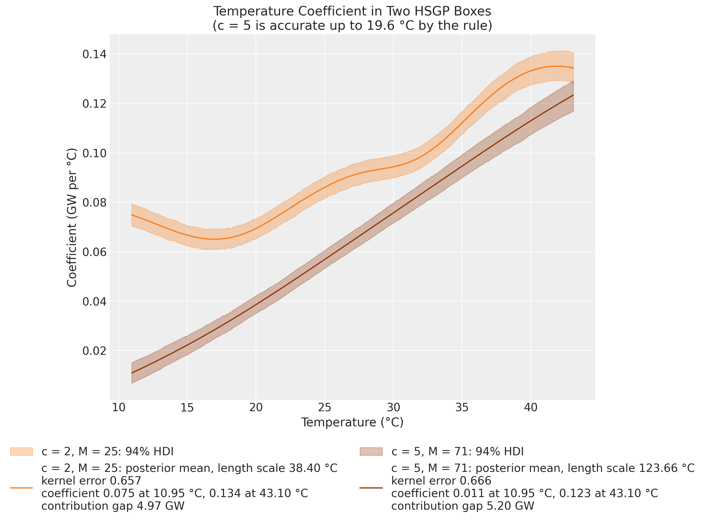</p>
</figure>


The wide box does not make the approximation accurate. Its posterior length scale grows to 123.66 °C, far beyond the 19.6 °C the rule allows, and the kernel error at that length scale is 0.666, about the same as for c = 2 (0.657). The posterior length scale grows with the box, so a larger box alone does not give an accurate approximation here. The two fits agree on what the demand data determine: the coefficient rises toward the hottest training hours, and the contribution gap is 4.97 GW with c = 2 and 5.20 GW with c = 5. They disagree on the rest. With c = 5 the coefficient rises monotonically from 0.011 at 10.95 °C, with no minimum inside the range and no cold-side rise, and it reaches 0.123 at 43.10 °C against 0.134 with c = 2. So the cold side of the coefficient, its minimum and its level at the hot end depend on the box. Only a different prior on the length scale or a different model form can settle them.


# Discussion

**What the results say.** A covariate-only model (an HSGP temperature coefficient, hour-of-day and day-of-week effects and a Student-t likelihood with a temperature-dependent scale) tracks the training weeks, with a central 90\\ interval that covers 0.918 of the training hours. The temperature effect on demand grows on hot days: in both HSGP boxes the coefficient rises toward the hottest training hours, and the contribution of temperature at the hottest training hour exceeds the one at the coldest by 4.97 GW (c = 2) and 5.20 GW (c = 5).

**Open weaknesses.**

- The posterior length scale (38.40 °C) sits far above the prior range \[3, 10\] °C, and there the HSGP approximation is off by up to 0.657 in correlation. A wider box does not help, because the posterior length scale grows with the box. The cold side of the coefficient, its minimum and its level at the hot end depend on the box. Only a different prior on the length scale or a different model form can settle them.
- The evaluation uses one split, and its test window is milder and calmer than the training weeks (peak 32.45 °C against 43.10 °C). The test score says little about heat-wave days, where demand peaks and the forecast bands are widest.
- The central 90\\ interval covers 0.991 of the test hours, so the forecast bands are too wide for the calm test window.
- The SVI posterior is multimodal, and the fit relies on `init_to_feasible` to land in the mode shown here.

**Fairness notes.** The model knows the calendar over the forecast horizon, which a forecaster also knows, and the realized hourly temperature over the horizon, which no forecaster knows. The `test` score is therefore the score with a perfect weather forecast. The `test (climatology)` forecast replaces the realized temperature with the hour-of-day mean of the training temperatures, which is known at forecast time: its CRPS is 0.310 against 0.187. That forecast treats one temperature path as known, so its coverage leaves out the uncertainty of the weather. The model sees no demand from the test window.


# References

- Orduz, J. [*Electricity Demand Forecast: Dynamic Time-Series Model*](https://juanitorduz.github.io/electricity_forecast/).
- Orduz, J. [*Time-Varying Regression Coefficients via Hilbert Space Gaussian Process Approximation*](https://juanitorduz.github.io/bikes_gp/).
- TensorFlow Probability. [*Structural Time Series Modeling Case Studies: Atmospheric CO2 and Electricity Demand*](https://www.tensorflow.org/probability/examples/Structural_Time_Series_Modeling_Case_Studies_Atmospheric_CO2_and_Electricity_Demand), using the [`tfp.sts`](https://www.tensorflow.org/probability/api_docs/python/tfp/sts) module.
- Riutort-Mayol, G., Bürkner, P.-C., Andersen, M. R., Solin, A., & Vehtari, A. (2023). [*Practical Hilbert space approximate Bayesian Gaussian processes for probabilistic programming*](https://doi.org/10.1007/s11222-022-10167-2). Statistics and Computing, 33, 17.
- NumPyro. [*Hilbert Space Gaussian Processes approximation*](https://num.pyro.ai/en/stable/contrib.html#hilbert-space-gaussian-processes-approximation).
- Hyndman, R. J., & Athanasopoulos, G. [*Forecasting: Principles and Practice*](https://otexts.com/fpp3/).
- [*Continuous Ranked Probability Score*](https://en.wikipedia.org/wiki/Scoring_rule#Continuous_ranked_probability_score) (Wikipedia).
