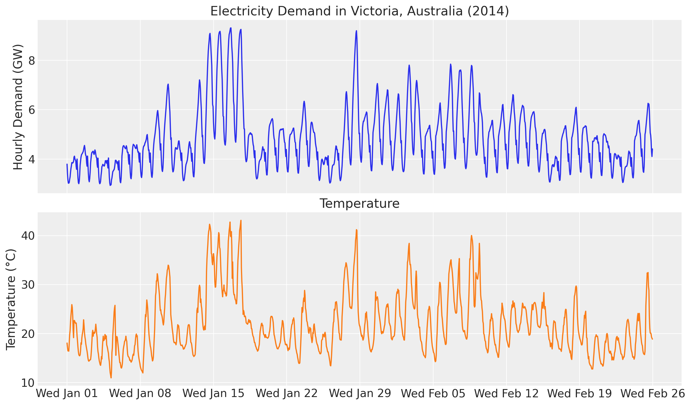
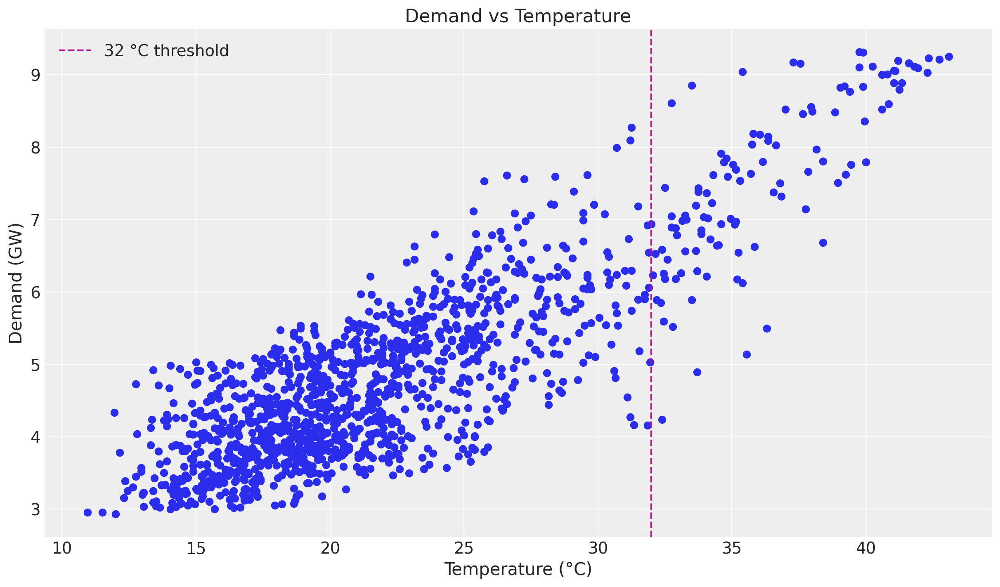
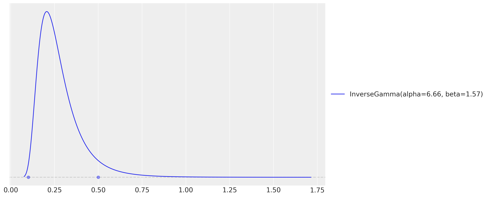
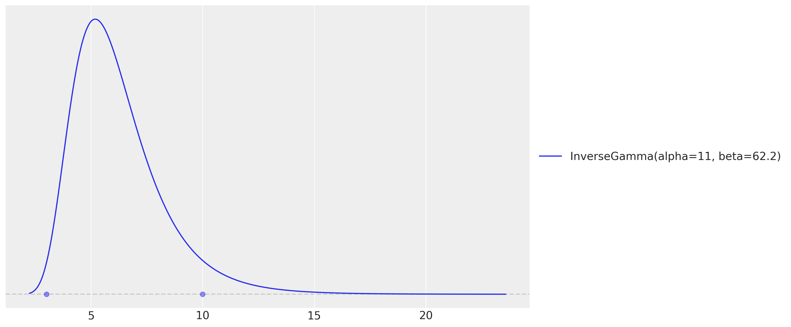
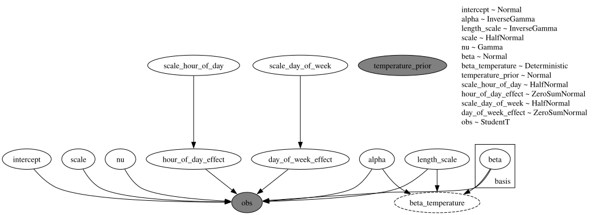
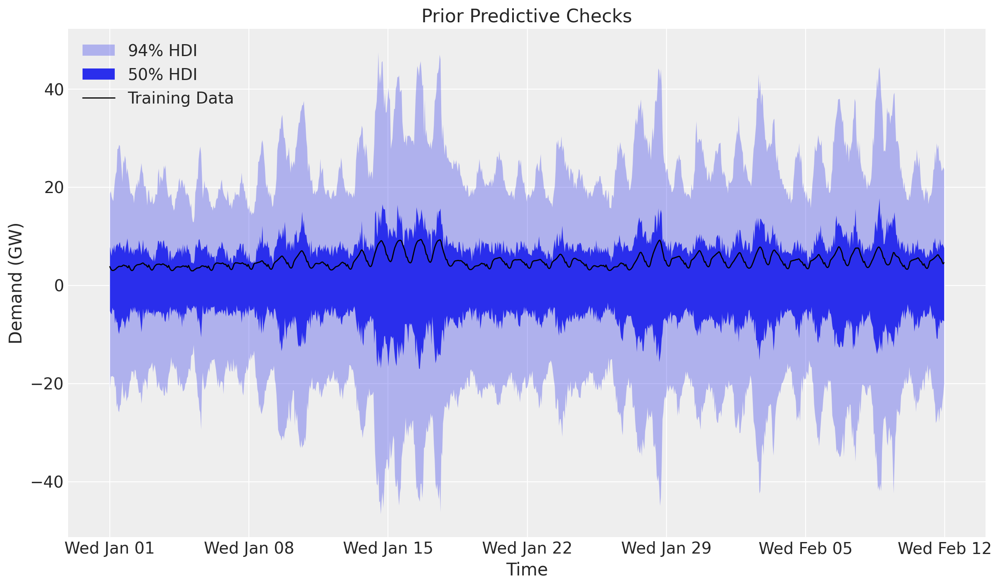
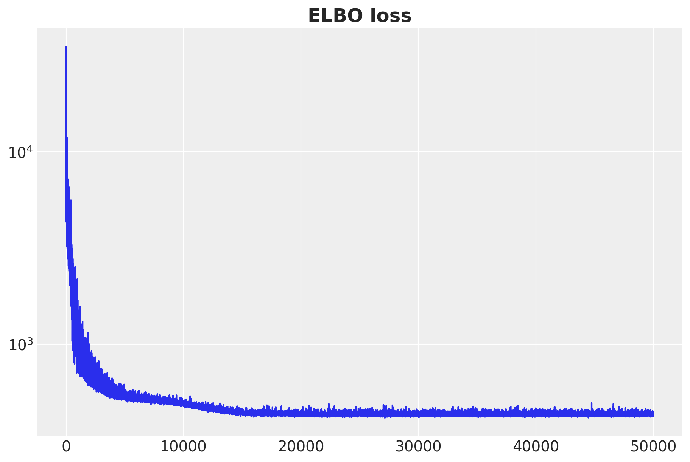
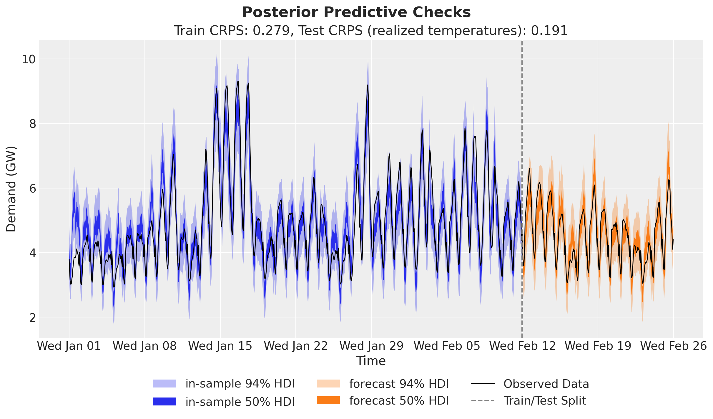
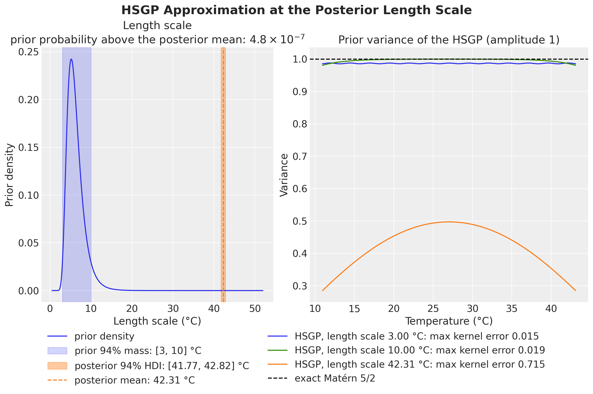
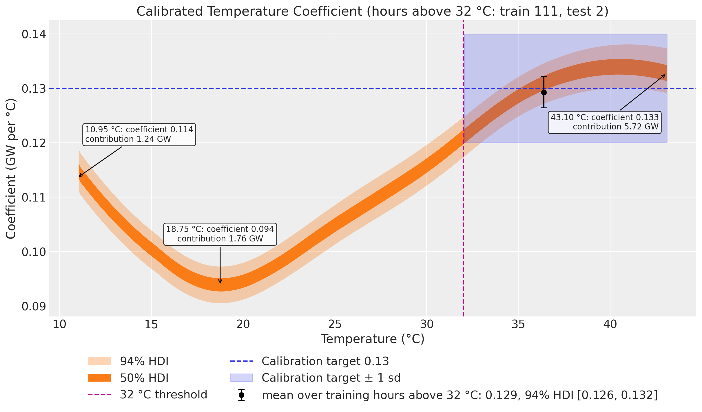

# Electricity demand forecasting: prior calibration


Electricity demand forecasting: prior calibration with `numpyro_forecast`

This notebook ports the blog post [**Electricity Demand Forecast: Prior Calibration**](https://juanitorduz.github.io/electricity_forecast_with_priors/) to the [`numpyro_forecast`](https://github.com/juanitorduz/numpyro_forecast) package. It is a direct continuation of the [electricity demand forecasting example](electricity_forecast.md): we keep the exact same model (a varying-coefficient temperature effect via a Hilbert Space Gaussian Process, plus hour-of-day and day-of-week seasonality and a Student-t likelihood) and add a single new ingredient, a *calibration likelihood*.

The idea of calibration is to inject domain knowledge into the model as an extra likelihood term. Suppose that, from experimental or observational data, we believe the effect of temperature on demand stabilizes at a known value once it gets hot enough, say around `0.13` for temperatures above `32 °C`. Instead of only encoding this through priors, we observe the latent temperature effect directly in that regime. The `obs=` argument turns a `sample` statement into a likelihood, so the posterior now has to explain both the demand data *and* this belief about the temperature effect at extreme values.

Throughout the package, time lives at axis `-2` and the observation dimension at `-1`, and the forecast horizon is inferred from the covariates being longer than the data.


# Prepare notebook


``` python
import warnings

# preliz warns at import time when PyMC is not installed; this example does not use PyMC.
warnings.filterwarnings("ignore", message="PyMC not installed", category=UserWarning)

%load_ext autoreload
%autoreload 2
%load_ext jaxtyping
%jaxtyping.typechecker beartype.beartype
%config InlineBackend.figure_format = "retina"

from typing import cast

import arviz as az
import jax.numpy as jnp
import matplotlib.dates as mdates
import matplotlib.pyplot as plt
import numpy as np
import numpyro
import numpyro.distributions as dist
import numpyro.handlers
import pandas as pd
import preliz as pz
from jax import random
from numpyro.contrib.hsgp.approximation import hsgp_matern
from numpyro.contrib.hsgp.laplacian import eigenfunctions
from numpyro.contrib.hsgp.spectral_densities import diag_spectral_density_matern
from numpyro.infer import SVI, Predictive, Trace_ELBO, init_to_feasible
from numpyro.infer.autoguide import AutoNormal
from numpyro.optim import Adam

from numpyro_forecast import (
    Horizon,
    draw_posterior,
    evaluate_forecast,
    forecast,
    predict,
    predict_in_sample,
)
from numpyro_forecast.datasets import load_victoria_electricity
from numpyro_forecast.features import periodic_repeat
from numpyro_forecast.typing import Array

az.style.use("arviz-darkgrid")
plt.rcParams["figure.figsize"] = [12, 7]
plt.rcParams["figure.dpi"] = 100
plt.rcParams["figure.facecolor"] = "white"

numpyro.set_host_device_count(n=4)

rng_key = random.PRNGKey(seed=42)
```


# Load data

We load the data through the package helper [load_victoria_electricity](../../reference/datasets.load_victoria_electricity.md#numpyro_forecast.datasets.load_victoria_electricity), which returns the demand series (shape `(time, 1)`, the package convention) and the aligned temperature series. We reference the original comment from the TensorFlow Probability example:

> *"Victoria electricity demand dataset, as presented at https://otexts.com/fpp2/scatterplots.html and downloaded from https://github.com/robjhyndman/fpp2-package/blob/master/data/elecdaily.rda . This series contains the first eight weeks (starting Jan 1). The original dataset was half-hourly data; here we've downsampled to hourly data by taking every other timestep."*


``` python
demand, temperature = load_victoria_electricity()
duration = demand.shape[0]

demand_values = np.asarray(demand[:, 0])
temperature_values = np.asarray(temperature)

demand_dates = np.array("2014-01-01", dtype="datetime64[h]") + np.arange(duration)
demand_loc = mdates.WeekdayLocator(byweekday=mdates.WE)
demand_fmt = mdates.DateFormatter("%a %b %d")

print("demand shape:", demand.shape)
print("temperature shape:", temperature.shape)
```


    demand shape: (1344, 1)
    temperature shape: (1344,)


Let's visualize the data:


``` python
fig, ax = plt.subplots(nrows=2, ncols=1, sharex=True, sharey=False, layout="constrained")
ax[0].plot(demand_dates, demand_values, c="C0")
ax[0].set(
    title="Electricity Demand in Victoria, Australia (2014)",
    ylabel="Hourly Demand (GW)",
)
ax[1].plot(demand_dates, temperature_values, c="C1")
ax[1].set(title="Temperature", ylabel="Temperature (°C)")
ax[1].xaxis.set_major_locator(demand_loc)
ax[1].xaxis.set_major_formatter(demand_fmt)
```


<figure class="figure">
<p></p>
</figure>


As in the baseline example, there is a clear positive correlation between temperature and demand, and the relationship is non-linear. The scatter plot below motivates the calibration: at the high end of the temperature range the air-conditioning effect dominates and the per-degree effect on demand settles around a stable value. This is exactly the regime where we will anchor the model with domain knowledge.


``` python
fig, ax = plt.subplots()
ax.scatter(temperature_values, demand_values)
ax.axvline(x=32.0, color="C3", linestyle="--", label="32 °C threshold")
ax.legend()
ax.set(title="Demand vs Temperature", xlabel="Temperature (°C)", ylabel="Demand (GW)");
```


<figure class="figure">
<p></p>
</figure>


# Training and test data

We split the data as in the original example, holding out the last two weeks. We build the exogenous inputs the model needs and pack them into a single `covariates` array with time at axis `-2`: the temperature and a `day_of_week` index. The forecast horizon is inferred later from `covariates` being longer than the training data.


``` python
num_forecast_steps = 24 * 7 * 2  # two weeks
t_train = duration - num_forecast_steps

data_train = demand[:t_train]
data_test = demand[t_train:]

dates_train = demand_dates[:t_train]
dates_test = demand_dates[t_train:]

day_of_week = np.array([d.weekday() for d in demand_dates.astype("datetime64[D]").astype(object)])

covariates = jnp.stack([temperature, jnp.asarray(day_of_week, dtype=jnp.float32)], axis=-1)
covariates_train = covariates[:t_train]

print("data_train shape:", data_train.shape)
print("data_test shape:", data_test.shape)
print("covariates shape:", covariates.shape)
```


    data_train shape: (1008, 1)
    data_test shape: (336, 1)
    covariates shape: (1344, 2)


# Model specification

The model is the same plain NumPyro model function as in the baseline example, built with the `numpyro_forecast` [predict](../../reference/models.predict.md#numpyro_forecast.models.predict) building block:

- A linear-in-features model predicts demand from temperature and two seasonal effects, hour of day and day of week, both modeled with Zero-Sum Normal distributions.
- A Matérn 5/2 kernel models the temperature effect on demand through the Hilbert Space Gaussian Process (HSGP) approximation from NumPyro.
- The noise scale varies with the temperature, and a Student-t distribution models the residual error.

The only addition is the **calibration likelihood**. We assume that, from domain knowledge, the effect of temperature on demand for temperatures over `32 °C` is stable at around `0.13`. We encode this as an extra observation on the latent Gaussian Process coefficient `beta_temperature`.


## The calibration likelihood: index vs mask

In the standalone NumPyro model from the blog post, the calibration term is written by indexing the latent effect at the high-temperature timesteps:

``` python
temperature_prior_idx = jnp.where(temperature_training_data > 32.0)[0]
numpyro.sample(
    "temperature_prior",
    dist.Normal(loc=0.13, scale=0.01),
    obs=beta_temperature[temperature_prior_idx],
)
```

In `numpyro_forecast` a single model handles both training and forecasting, so `covariates` (and therefore `beta_temperature`) change length between the two regimes and a fixed integer index does not translate cleanly. The idiomatic, jit-safe equivalent is a *masked* likelihood: we build a boolean mask from the temperature covariate and apply it with `numpyro.handlers.mask`.

These two formulations are mathematically identical at training time. `numpyro.handlers.mask` multiplies each element's `log_prob` by the `0/1` mask, so the calibration factor is the sum of `Normal(0.13, 0.01).log_prob(beta_temperature[t])` over exactly the timesteps where `temperature[t] > 32 °C`, the same terms the index version sums. The mask form has static shapes, works for both the in-sample fit and the forecast horizon, and during forecasting is harmless because `beta_temperature` is deterministic given the posterior and the forecast only reads the [forecast](../../reference/predictive.forecast.md#numpyro_forecast.predictive.forecast) site.


## GP prior parameters

As in the baseline example, we set the Gaussian Process amplitude and length-scale priors with `preliz` by assuming both come from an Inverse-Gamma distribution and specifying the support. We also pass `mass=0.94` explicitly, so the priors do not depend on the default of the installed preliz version.


``` python
# For the amplitude, we set the values inspired on the range of the demand / temperature
# ratio.
amplitude_params, ax = pz.maxent(pz.InverseGamma(), lower=0.1, upper=0.5, mass=0.94)
```


<figure class="figure">
<p></p>
</figure>


``` python
# As we want to use the GP to model the temperature effect, we need to set the length
# scale parameter. We expect these effects to be seen at the order of units or tens of
# units, so we expect the length scale to be between 3 and 10.
LENGTH_SCALE_LOWER = 3.0
LENGTH_SCALE_UPPER = 10.0
length_scale_params, ax = pz.maxent(
    pz.InverseGamma(), lower=LENGTH_SCALE_LOWER, upper=LENGTH_SCALE_UPPER, mass=0.94
)
```


<figure class="figure">
<p></p>
</figure>


These two `maxent` calls return the fitted Inverse-Gamma distributions, and the model below builds its amplitude and length-scale priors from their `alpha` and `beta` parameters, so the priors in the model are the priors in the plots above. The model is identical to the baseline, with the masked calibration likelihood added just after the `beta_temperature` deterministic site. As in the baseline, the GP input is the temperature minus `TEMP_CENTER`, the midpoint of the training temperature range, and `ELL` is the half-width L of the box \[-L, L\] that must contain that input (not a factor of the data range), set to twice the training half-range. The [baseline example](electricity_forecast.md) explains why both come from the training temperatures and not from `covariates` inside the model. The HSGP settings and the three calibration numbers (threshold, target mean, target scale) are module constants, so the plots below can read them back. The calibration mask, the linear term and the noise scale use the raw temperature.


``` python
# HSGP input: the temperature centered on the training midrange. NumPyro's ``ell`` is the
# half-width L of the box [-L, L] that must contain the centered input, not a factor of the
# data range; we take twice the training half-range. Both constants come from the training
# temperatures, never from ``covariates`` inside the model (it sees other covariates at
# forecast time).
temperature_train = np.asarray(temperature[:t_train])
TEMP_CENTER = float(temperature_train.min() + temperature_train.max()) / 2
TEMP_HALF_RANGE = float(temperature_train.max() - temperature_train.min()) / 2
ELL = 2.0 * TEMP_HALF_RANGE  # HSGP box half-width L
M = 25  # number of HSGP basis functions
# GP priors from the maxent fits above (preliz alpha, beta are NumPyro concentration, rate).
AMPLITUDE_PRIOR = dist.InverseGamma(
    concentration=amplitude_params.alpha, rate=amplitude_params.beta
)
LENGTH_SCALE_PRIOR = dist.InverseGamma(
    concentration=length_scale_params.alpha, rate=length_scale_params.beta
)
TEMP_THRESHOLD = 32.0  # temperature (°C) above which the calibration likelihood applies
PRIOR_MEAN = 0.13  # domain-knowledge mean of the temperature effect above the threshold
PRIOR_SCALE = 0.01  # scale (uncertainty) of the calibration likelihood


def calibrated_electricity_model(covariates: Array, data: Array | None = None) -> None:
    """HSGP temperature effect with hour/day seasonality and a calibration likelihood.

    Same model as ``electricity_model`` in the baseline example, plus a masked
    Normal likelihood on the latent temperature effect that anchors it to a
    domain-knowledge value in the high-temperature regime.
    """
    h = Horizon.from_data(covariates, data)
    duration = covariates.shape[-2]
    temperature = covariates[..., 0]
    day_of_week = covariates[..., 1].astype("int32")

    # Intercept.
    intercept = numpyro.sample("intercept", dist.Normal(loc=0.0, scale=2.0))

    # GP parameters (amplitude and length-scale priors are the preliz maxent fits).
    alpha = numpyro.sample("alpha", AMPLITUDE_PRIOR)
    length_scale = numpyro.sample("length_scale", LENGTH_SCALE_PRIOR)
    scale_factor = numpyro.sample("scale", dist.HalfNormal(scale=0.5))
    # Degrees of freedom for the Student-t likelihood.
    nu = numpyro.sample("nu", dist.Gamma(concentration=8.0, rate=3.0))

    # Non-linear temperature effect as a Matérn 5/2 HSGP of the centered temperature.
    # ``hsgp_matern`` is annotated for float hyperparameters, so we cast the sampled scalars.
    beta_temperature = hsgp_matern(
        x=temperature - TEMP_CENTER,
        nu=5 / 2,
        alpha=cast("float", alpha),
        length=cast("float", length_scale),
        ell=ELL,
        m=M,
    )
    numpyro.deterministic("beta_temperature", beta_temperature)

    # Calibration likelihood: anchor the latent temperature effect to the
    # domain-knowledge value where temperature exceeds the threshold. The mask
    # keeps only the high-temperature contributions, matching the blog's
    # ``beta_temperature[temperature_prior_idx]`` indexing.
    high_temp_mask = temperature > TEMP_THRESHOLD
    with numpyro.handlers.mask(mask=high_temp_mask):
        numpyro.sample(
            "temperature_prior",
            dist.Normal(loc=PRIOR_MEAN, scale=PRIOR_SCALE),
            obs=beta_temperature,
        )

    # Hour-of-day effect, tiled over the horizon with periodic_repeat.
    scale_hour_of_day = numpyro.sample("scale_hour_of_day", dist.HalfNormal(scale=0.5))
    hour_of_day_effect = numpyro.sample(
        "hour_of_day_effect",
        dist.ZeroSumNormal(scale=scale_hour_of_day, event_shape=(24,)),
    )
    hour_of_day_effect = periodic_repeat(hour_of_day_effect, duration, axis=-1)

    # Day-of-week effect, indexed by the calendar covariate.
    scale_day_of_week = numpyro.sample("scale_day_of_week", dist.HalfNormal(scale=0.5))
    day_of_week_effect = numpyro.sample(
        "day_of_week_effect",
        dist.ZeroSumNormal(scale=scale_day_of_week, event_shape=(7,)),
    )

    # Expected demand and a temperature-dependent Student-t noise scale.
    mu = (
        beta_temperature * temperature
        + intercept
        + hour_of_day_effect
        + jnp.take(day_of_week_effect, day_of_week)
    )
    scale = scale_factor * jnp.sqrt(temperature)

    predict(h, dist.StudentT(df=nu, loc=0.0, scale=scale[..., None]), mu[..., None])
```


The model function is a plain NumPyro model callable `(covariates, data=None)`, so we can render its structure directly. The rendered graph shows the new observed `temperature_prior` node next to the demand `obs` node.


``` python
numpyro.render_model(
    calibrated_electricity_model,
    model_args=(covariates_train, data_train),
    render_distributions=True,
    render_params=True,
)
```


<figure class="figure">
<p></p>
</figure>


# Prior predictive checks

Before we fit the model, let's visualize the prior predictive distribution. The model function is a plain NumPyro model, so we hand it to `Predictive` directly. We draw the bands with ArviZ's `plot_lm`, which computes the 50\\ and 94\\ HDI internally; since the time axis is a `datetime64` array we pass it as matplotlib date numbers (`mdates.date2num`) and restore the date formatter on the returned axis.


``` python
prior_predictive = Predictive(
    calibrated_electricity_model, num_samples=2_000, return_sites=["obs"]
)
rng_key, rng_subkey = random.split(rng_key)
prior_obs = prior_predictive(rng_subkey, covariates_train)["obs"][..., 0]

xnum_train = mdates.date2num(dates_train)

idata_prior = az.from_dict(
    {
        "prior_predictive": {"obs": np.asarray(prior_obs)[None]},
        "observed_data": {"obs": np.asarray(data_train[:, 0])},
        "constant_data": {"date": xnum_train},
    },
    coords={"time": xnum_train},
    dims={"obs": ["time"], "date": ["time"]},
)
pc = az.plot_lm(
    idata_prior,
    y="obs",
    x="date",
    group="prior_predictive",
    ci_kind="hdi",
    ci_prob=(0.5, 0.94),
    smooth=False,
    visuals={"ci_band": {"color": "C0"}, "observed_scatter": False, "pe_line": False},
    figure_kwargs={"figsize": (12, 7)},
)
ax = pc.viz["figure"].item().axes[0]
bands = pc.viz["ci_band"]["date"]
band_94, band_50 = bands.sel(prob=0.94).item(), bands.sel(prob=0.5).item()
band_94.set_label(r"$94\%$ HDI")
band_50.set_label(r"$50\%$ HDI")
(train_line,) = ax.plot(
    xnum_train, np.asarray(data_train[:, 0]), c="black", lw=1, label="Training Data"
)
ax.xaxis.set_major_locator(demand_loc)
ax.xaxis.set_major_formatter(demand_fmt)
ax.legend(handles=[band_94, band_50, train_line])
ax.set(title="Prior Predictive Checks", ylabel="Demand (GW)", xlabel="Time");
```


<figure class="figure">
<p></p>
</figure>


The prior predictive 94\\ band is several times wider than the range of the training demand and includes negative demand. The prior is weak, so the demand data and the calibration term do most of the work.


# Inference with SVI

We fit the model with plain NumPyro stochastic variational inference: an `AutoNormal` guide, `Adam`, and `SVI.run`, which returns the fitted `params` and the ELBO `losses`. As in the baseline example, the posterior is multimodal: the multiplicative `beta_temperature * temperature` term trades off against the overall level, so the starting point of the guide decides which mode SVI reaches. We initialize the guide at a feasible point (`init_to_feasible`). The *Accuracy of the HSGP approximation* section below shows which parts of the fitted coefficient depend on the HSGP setup. We keep the same optimizer (`Adam(step_size=0.005)`) and number of steps (`50_000`) as the blog post.


``` python
rng_key, rng_subkey = random.split(rng_key)
guide = AutoNormal(calibrated_electricity_model, init_loc_fn=init_to_feasible)
svi = SVI(calibrated_electricity_model, guide, Adam(step_size=0.005), Trace_ELBO())
svi_result = svi.run(rng_subkey, 50_000, covariates_train, data_train, progress_bar=False)

fig, ax = plt.subplots(figsize=(9, 6))
ax.plot(svi_result.losses)
ax.set_yscale("log")
ax.set_title("ELBO loss", fontsize=18, fontweight="bold");
```


<figure class="figure">
<p></p>
</figure>


The ELBO loss is decreasing as expected.


# Posterior predictive checks

We now draw posterior latents from the fitted guide with [draw_posterior](../../reference/predictive.draw_posterior.md#numpyro_forecast.predictive.draw_posterior), push them through the model over the training window with [predict_in_sample](../../reference/predictive.predict_in_sample.md#numpyro_forecast.predictive.predict_in_sample), and forecast the held-out two weeks with [forecast](../../reference/predictive.forecast.md#numpyro_forecast.predictive.forecast) and the full-horizon covariates. Their temperature column holds the realized temperatures of the test window, so this forecast assumes a perfect weather forecast (the [baseline example](electricity_forecast.md) also scores a forecast with a temperature path known at forecast time). [draw_posterior](../../reference/predictive.draw_posterior.md#numpyro_forecast.predictive.draw_posterior) returns the deterministic sites along with the latents, so the posterior dictionary already carries `beta_temperature` for the calibrated temperature-effect plot later.


``` python
num_posterior_samples = 5_000

rng_key, key_post, key_pp, key_fc = random.split(rng_key, 4)
posterior = draw_posterior(key_post, guide, svi_result.params, num_posterior_samples)
train_pp = predict_in_sample(key_pp, calibrated_electricity_model, posterior, covariates_train)
forecast_draws = forecast(key_fc, calibrated_electricity_model, posterior, data_train, covariates)
```


## Forecast evaluation

We score the train and test forecasts with [evaluate_forecast](../../reference/evaluate.evaluate_forecast.md#numpyro_forecast.evaluate.evaluate_forecast), which reports several metrics at once: CRPS (the [Continuous Ranked Probability Score](https://en.wikipedia.org/wiki/Scoring_rule#Continuous_ranked_probability_score)), mean absolute error, root mean squared error, and the empirical coverage of the central 90\\ prediction interval.


``` python
train_metrics = evaluate_forecast(train_pp, data_train)
test_metrics = evaluate_forecast(forecast_draws, data_test)

metrics_table = pd.DataFrame({"train": train_metrics, "test": test_metrics})
metrics_table
```


|          | train    | test     |
|----------|----------|----------|
| mae      | 0.385787 | 0.262353 |
| rmse     | 0.519173 | 0.332261 |
| crps     | 0.279181 | 0.190729 |
| coverage | 0.917659 | 0.994048 |


The test scores are conditional on the realized temperatures of the test window, so they are an optimistic reading of the forecast accuracy. The test CRPS (0.191) is lower than the train CRPS (0.279), but the train column scores the data the model was fitted to, so the two columns do not test generalization. The central 90\\ interval covers 0.918 of the training hours and 0.994 of the test hours, so it is too wide on the test window. Next we compare the posterior predictive distribution with the training and test data.


``` python
train_obs = train_pp[..., 0]
forecast_obs = forecast_draws[..., 0]

xnum_test = mdates.date2num(dates_test)

idata_train = az.from_dict(
    {
        "posterior_predictive": {"obs": np.asarray(train_obs)[None]},
        "observed_data": {"obs": np.asarray(data_train[:, 0])},
        "constant_data": {"date": xnum_train},
    },
    coords={"time": xnum_train},
    dims={"obs": ["time"], "date": ["time"]},
)
idata_test = az.from_dict(
    {
        "posterior_predictive": {"obs": np.asarray(forecast_obs)[None]},
        "observed_data": {"obs": np.asarray(data_test[:, 0])},
        "constant_data": {"date": xnum_test},
    },
    coords={"time": xnum_test},
    dims={"obs": ["time"], "date": ["time"]},
)

pc = az.plot_lm(
    idata_train,
    y="obs",
    x="date",
    ci_kind="hdi",
    ci_prob=(0.5, 0.94),
    smooth=False,
    visuals={"ci_band": {"color": "C0"}, "observed_scatter": False, "pe_line": False},
    figure_kwargs={"figsize": (12, 7)},
)
train_bands = pc.viz["ci_band"]["date"]
band_train_94 = train_bands.sel(prob=0.94).item()
band_train_50 = train_bands.sel(prob=0.5).item()
az.plot_lm(
    idata_test,
    y="obs",
    x="date",
    plot_collection=pc,
    ci_kind="hdi",
    ci_prob=(0.5, 0.94),
    smooth=False,
    visuals={"ci_band": {"color": "C1"}, "observed_scatter": False, "pe_line": False},
)
test_bands = pc.viz["ci_band"]["date"]
band_test_94 = test_bands.sel(prob=0.94).item()
band_test_50 = test_bands.sel(prob=0.5).item()
ax = pc.viz["figure"].item().axes[0]
band_train_94.set_label(r"in-sample $94\%$ HDI")
band_train_50.set_label(r"in-sample $50\%$ HDI")
band_test_94.set_label(r"forecast $94\%$ HDI")
band_test_50.set_label(r"forecast $50\%$ HDI")
obs_dates = mdates.date2num(np.concatenate([dates_train, dates_test]))
obs_values = np.concatenate([np.asarray(data_train[:, 0]), np.asarray(data_test[:, 0])])
(obs_line,) = ax.plot(obs_dates, obs_values, c="black", lw=1, label="Observed Data")
split_line = ax.axvline(x=xnum_train[-1], color="gray", linestyle="--", label="Train/Test Split")
ax.xaxis.set_major_locator(demand_loc)
ax.xaxis.set_major_formatter(demand_fmt)
ax.legend(
    handles=[band_train_94, band_train_50, band_test_94, band_test_50, obs_line, split_line],
    loc="upper center",
    bbox_to_anchor=(0.5, -0.1),
    ncol=3,
)
ax.set(
    title=(
        f"Train CRPS: {train_metrics['crps']:.3f}, "
        f"Test CRPS (realized temperatures): {test_metrics['crps']:.3f}"
    ),
    ylabel="Demand (GW)",
    xlabel="Time",
)
fig = pc.viz["figure"].item()
fig.suptitle("Posterior Predictive Checks", fontsize=18, fontweight="bold");
```


<figure class="figure">
<p></p>
</figure>


The forecast bands follow the test demand closely, because the forecast reads the realized test temperatures. The forecast bands are wide on the test window, most of all on the warmest test day at its end, which matches the test coverage of 0.994 in the table.


## Accuracy of the HSGP approximation

Before we read the fitted temperature coefficient, we check how well the HSGP approximation matches the Matérn 5/2 kernel at the length scale the fit selects. The left panel compares the posterior length scale with its prior. The right panel shows the prior variance of the approximate GP along the training temperature range (the exact Matérn 5/2 kernel with amplitude 1 has variance 1 everywhere) at the two prior bounds and at the posterior mean. Its legend gives the largest gap between the approximate and the exact correlation over a grid of 200 training temperatures. The check needs no refit: `hsgp_correlation` builds the basis with the model's `TEMP_CENTER`, `ELL` and `M`.


``` python
def matern52_correlation(x: Array, length_scale: float) -> Array:
    """Exact Matérn 5/2 correlation between every pair of inputs."""
    s = jnp.sqrt(5.0) * jnp.abs(x[:, None] - x[None, :]) / length_scale
    return (1 + s + s**2 / 3) * jnp.exp(-s)


def hsgp_correlation(x: Array, length_scale: float) -> Array:
    """HSGP approximation of the same correlation, with the model's center, box and basis."""
    phi = eigenfunctions(x=x - TEMP_CENTER, ell=ELL, m=M)
    spd = diag_spectral_density_matern(
        nu=5 / 2, alpha=1.0, length=length_scale, ell=ELL, m=M, dim=1
    )
    return (phi * spd) @ phi.T


# Posterior length scale against the prior.
length_scale_draws = np.asarray(posterior["length_scale"])
posterior_length_scale = float(length_scale_draws.mean())
length_scale_hdi = az.hdi(length_scale_draws, prob=0.94)
prior_tail = float(1 - LENGTH_SCALE_PRIOR.cdf(jnp.asarray(posterior_length_scale)))
mantissa, exponent = f"{prior_tail:.1e}".split("e")

# Largest kernel error on a grid over the training temperatures.
temperature_grid = jnp.linspace(temperature_train.min(), temperature_train.max(), 200)
checked_length_scales = (LENGTH_SCALE_LOWER, LENGTH_SCALE_UPPER, posterior_length_scale)
max_errors = [
    float(
        jnp.max(
            jnp.abs(
                hsgp_correlation(temperature_grid, length_scale)
                - matern52_correlation(temperature_grid, length_scale)
            )
        )
    )
    for length_scale in checked_length_scales
]

fig, ax = plt.subplots(
    nrows=1, ncols=2, figsize=(12, 8), width_ratios=[1, 1.2], layout="constrained"
)
length_scale_grid = np.linspace(0.5, 1.2 * length_scale_draws.max(), 1_000)
ax[0].plot(
    length_scale_grid,
    np.exp(np.asarray(LENGTH_SCALE_PRIOR.log_prob(jnp.asarray(length_scale_grid)))),
    c="C0",
    label="prior density",
)
ax[0].axvspan(
    LENGTH_SCALE_LOWER,
    LENGTH_SCALE_UPPER,
    color="C0",
    alpha=0.2,
    label=rf"prior $94\%$ mass: [{LENGTH_SCALE_LOWER:.0f}, {LENGTH_SCALE_UPPER:.0f}] °C",
)
ax[0].axvspan(
    *length_scale_hdi,
    color="C1",
    alpha=0.4,
    label=rf"posterior $94\%$ HDI: [{length_scale_hdi[0]:.2f}, {length_scale_hdi[1]:.2f}] °C",
)
ax[0].axvline(
    posterior_length_scale,
    color="C1",
    linestyle="--",
    label=f"posterior mean: {posterior_length_scale:.2f} °C",
)
ax[0].set(
    title=(
        "Length scale\nprior probability above the posterior mean: "
        rf"${mantissa} \times 10^{{{int(exponent)}}}$"
    ),
    xlabel="Length scale (°C)",
    ylabel="Prior density",
)

for color, length_scale, max_error in zip(
    ["C0", "C2", "C1"], checked_length_scales, max_errors, strict=True
):
    ax[1].plot(
        temperature_grid,
        jnp.diag(hsgp_correlation(temperature_grid, length_scale)),
        c=color,
        label=f"HSGP, length scale {length_scale:.2f} °C: max kernel error {max_error:.3f}",
    )

ax[1].axhline(1.0, color="black", linestyle="--", label="exact Matérn 5/2")
ax[1].set(
    title="Prior variance of the HSGP (amplitude 1)",
    xlabel="Temperature (°C)",
    ylabel="Variance",
)
handles_0, labels_0 = ax[0].get_legend_handles_labels()
handles_1, labels_1 = ax[1].get_legend_handles_labels()
fig.legend(handles_0 + handles_1, labels_0 + labels_1, loc="outside lower center", ncols=2)
fig.suptitle("HSGP Approximation at the Posterior Length Scale", fontsize=18, fontweight="bold");
```


<figure class="figure">
<p></p>
</figure>


At both bounds of the prior range the approximation is accurate: the largest kernel error is 0.015 at a length scale of 3 °C and 0.019 at a length scale of 10 °C. The posterior length scale is 42.31 °C (94\\ HDI \[41.77, 42.82\] °C), far outside that range: the prior gives a probability of 4.8 \times 10^{-7} to a length scale above it, so the data and the prior disagree. At the posterior length scale the approximate kernel is far from the Matérn 5/2 kernel (largest error 0.715). Its prior variance is well below 1 over the whole range and lowest at both ends, because the basis functions vanish at the box edges \pm L. So the shape of the calibrated coefficient near the ends of the temperature range, and the location of its minimum, are outputs of this approximation, not findings about demand. We read the coefficient with this in mind in the next section.


## Temperature effect on demand

This is where the calibration shows up. We plot the posterior distribution of the Gaussian Process component `beta_temperature` against temperature, sorting by temperature so the HDI band reads cleanly. The vertical line marks the `32 °C` threshold and the shaded band shows the calibration target of `0.13 ± 0.01` for temperatures above it. The black point is the coefficient averaged over the training hours above the threshold, with its 94\\ HDI. The annotations give the posterior mean coefficient and contribution `beta_temperature * temperature` at the coldest training hour, at the lowest coefficient and at the hottest training hour, and the title counts the hours above the threshold in each window.


``` python
temperature_test = np.asarray(temperature[t_train:])
order = np.argsort(temperature_train)
beta_temperature = posterior["beta_temperature"]

prior_mean = PRIOR_MEAN
prior_scale = PRIOR_SCALE
threshold = TEMP_THRESHOLD

idata_beta = az.from_dict(
    {
        "posterior_predictive": {"obs": np.asarray(beta_temperature[:, order])[None]},
        "observed_data": {"obs": np.zeros_like(temperature_train[order])},
        "constant_data": {"temperature": temperature_train[order]},
    },
    dims={"obs": ["obs_dim"], "temperature": ["obs_dim"]},
)
pc = az.plot_lm(
    idata_beta,
    y="obs",
    x="temperature",
    ci_kind="hdi",
    ci_prob=(0.5, 0.94),
    visuals={"ci_band": {"color": "C1"}, "observed_scatter": False, "pe_line": False},
    figure_kwargs={"figsize": (12, 7)},
)
ax = pc.viz["figure"].item().axes[0]
bands = pc.viz["ci_band"]["temperature"]
band_94, band_50 = bands.sel(prob=0.94).item(), bands.sel(prob=0.5).item()
band_94.set_label(r"$94\%$ HDI")
band_50.set_label(r"$50\%$ HDI")
threshold_line = ax.axvline(
    x=threshold, color="C3", linestyle="--", label=f"{threshold:.0f} °C threshold"
)
target_line = ax.axhline(
    y=prior_mean, color="C0", linestyle="--", label=f"Calibration target {prior_mean}"
)
high_temp = (temperature_train[order] > threshold).tolist()
target_band = ax.fill_between(
    temperature_train[order],
    prior_mean - prior_scale,
    prior_mean + prior_scale,
    where=high_temp,
    color="C0",
    alpha=0.2,
    label="Calibration target ± 1 sd",
)

# Annotate the posterior mean coefficient and contribution at three training hours.
beta_mean = np.asarray(beta_temperature.mean(axis=0))
contribution_mean = np.asarray((beta_temperature * temperature_train).mean(axis=0))
annotated_hours = [
    (order[0], (10, 45), "left"),
    (int(beta_mean.argmin()), (0, 55), "center"),
    (order[-1], (-10, -70), "right"),
]

for i, offset, ha in annotated_hours:
    ax.annotate(
        f"{temperature_train[i]:.2f} °C: coefficient {beta_mean[i]:.3f}\n"
        f"contribution {contribution_mean[i]:.2f} GW",
        xy=(temperature_train[i], beta_mean[i]),
        xytext=offset,
        textcoords="offset points",
        ha=ha,
        bbox={"boxstyle": "round", "fc": "white", "alpha": 0.8},
        arrowprops={"arrowstyle": "->"},
    )

# Average coefficient over the training hours above the threshold, with its HDI.
above_threshold = temperature_train > threshold
num_above_train = int(above_threshold.sum())
num_above_test = int((temperature_test > threshold).sum())
beta_above = np.asarray(beta_temperature[:, above_threshold].mean(axis=1))
beta_above_hdi = az.hdi(beta_above, prob=0.94)
above_reading = ax.errorbar(
    x=float(temperature_train[above_threshold].mean()),
    y=float(beta_above.mean()),
    yerr=[[beta_above.mean() - beta_above_hdi[0]], [beta_above_hdi[1] - beta_above.mean()]],
    fmt="o",
    color="black",
    capsize=4,
    label=(
        f"mean over training hours above {threshold:.0f} °C: {beta_above.mean():.3f}, "
        rf"$94\%$ HDI [{beta_above_hdi[0]:.3f}, {beta_above_hdi[1]:.3f}]"
    ),
)
ax.legend(
    handles=[band_94, band_50, threshold_line, target_line, target_band, above_reading],
    loc="upper center",
    bbox_to_anchor=(0.5, -0.1),
    ncol=2,
)
ax.set(
    title=(
        f"Calibrated Temperature Coefficient (hours above {threshold:.0f} °C: "
        f"train {num_above_train}, test {num_above_test})"
    ),
    xlabel="Temperature (°C)",
    ylabel="Coefficient (GW per °C)",
);
```


<figure class="figure">
<p></p>
</figure>


Above the threshold the coefficient sits inside the target band: averaged over the 111 training hours above 32 °C, it has posterior mean 0.129 with 94\\ HDI \[0.126, 0.132\] (the black point), against the target 0.13 ± 0.01. The test window has only 2 hours above 32 °C, so the test scores above cannot show what the calibration changes. Below the threshold the coefficient has its minimum at 18.75 °C (0.094) and is higher at the coldest training hour (0.114 at 10.95 °C), but the *Accuracy of the HSGP approximation* section showed that this part of the curve is an output of the approximation. The contribution of temperature to demand also grows with temperature at the cold end: 1.24 GW at 10.95 °C against 1.76 GW at 18.75 °C.


# Discussion

**What the results say.** An extra observed `numpyro.sample` site, masked to the temperatures where the domain knowledge applies, anchors the latent coefficient to the target value: above 32 °C its posterior average is 0.129 against a target of 0.13. The mechanism is general: any latent quantity in a model function can be anchored with an extra observed site, which opens a way to calibrate forecasting models with experimental or observational data.

**Open weaknesses.**

- The test window has only 2 hours above 32 °C, so the test scores cannot show whether the calibration improves forecasts on hot days.
- The posterior length scale (42.31 °C) sits far above the prior range \[3, 10\] °C, where the HSGP approximation is off by up to 0.715 in correlation, so the cold-side rise of the coefficient and the location of its minimum are not findings about demand.
- The calibration target is assumed, not estimated here. With a scale of 0.01 the calibration term pulls the coefficient just as firmly toward a wrong target.
- The central 90\\ interval covers 0.994 of the test hours, so the forecast bands are too wide for the test window.

**Fairness notes.** The model knows the calendar and the realized hourly temperature over the forecast horizon, so the test scores assume a perfect weather forecast. The [baseline example](electricity_forecast.md) adds a forecast with a climatology temperature path, known at forecast time, to show the cost of not knowing the weather. The calibration target is external knowledge about the temperature effect, not data from the test window, and the model sees no demand from the test window.


# References

- Orduz, J. [*Electricity Demand Forecast: Prior Calibration*](https://juanitorduz.github.io/electricity_forecast_with_priors/).
- Orduz, J. [*Electricity Demand Forecast: Dynamic Time-Series Model*](https://juanitorduz.github.io/electricity_forecast/) (the uncalibrated baseline this notebook extends).
- [*Continuous Ranked Probability Score*](https://en.wikipedia.org/wiki/Scoring_rule#Continuous_ranked_probability_score) (Wikipedia).
